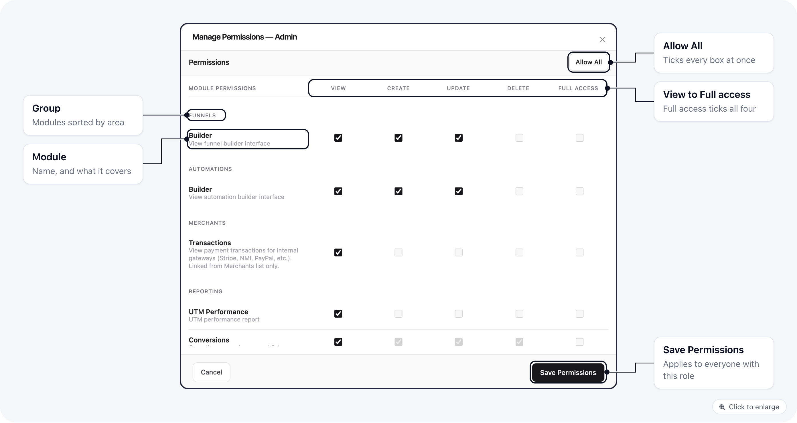
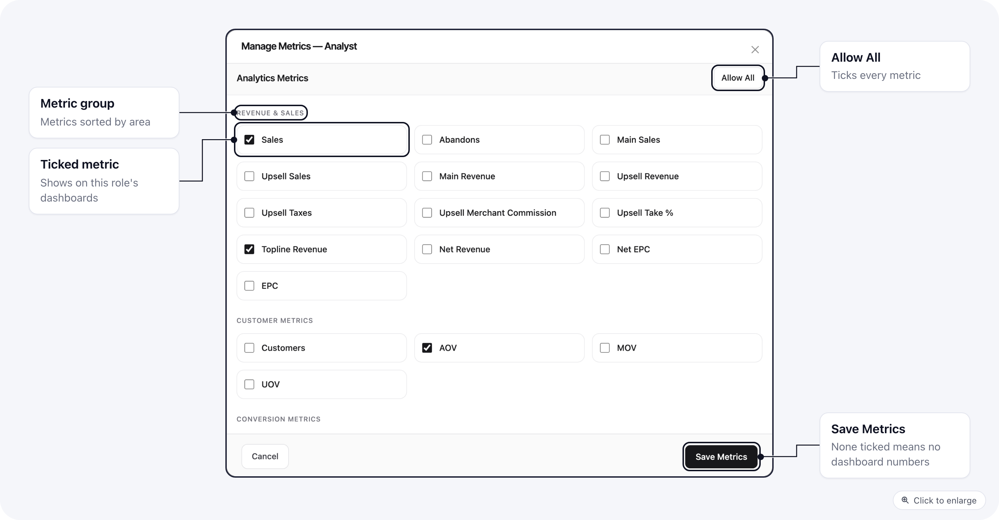

## How to use this page

This matrix is designed for brand owners and organization admins who need to build or troubleshoot roles.

- Use the **capability** column to find the behavior you want.
- Use the **permission** column to configure the role in **Settings > Roles > Manage Permissions** ([Organization roles](/settings/organization-roles#manage-permissions)). The key `pages.update` is the **Update** box on the **Pages** row.
- Also verify the related **module** is enabled for the brand.

## Core rules

- `*.view` usually controls whether a user can open a section or list.
- `*.create` controls creation flows.
- `*.update` controls edits, state changes, and many operational actions.
- `*.delete` controls destructive actions.
- `*.export` controls exports where supported.
- Metrics are separate from feature permissions.

## Common capability matrix

| Capability | Typical permission | Notes |
|-----------|--------------------|-------|
| Open Conversions list | `conversions.view` | Also requires the brand's conversions-related module to be enabled. |
| Create manual conversion-style flows | `conversions.create` | Plan rules may still limit creation in some cases. |
| Update conversion-related operational actions | `conversions.update` | Used for actions like subscription updates and fulfillment operational flows. |
| Open Customers report | `customers.view` | Separate from conversions visibility. |
| Export customers | `customers.export` | Export is separate from view. |
| Open Fulfillment list | `conversions.view` | Fulfillment list access is based on conversions access. |
| Configure or inspect integrations | `integrations.view` | Separate from fulfillment list visibility. |
| Open Merchants settings | `merchants.view` | Needed for merchant settings and some merchant-dependent selectors. |
| Open Products settings | `products.view` | Product management is separate from conversions/customers. |
| Open Pages | `pages.view` | Base pages access. |
| Open Advanced pages tools | `pagecomponents.view`, `collections.view`, `trackingscripts.view`, `backendscripts.view`, `files.view`, and related page permissions | Advanced page tooling can depend on several permissions. |
| Open Custom Reports | `reports.view` | In some UI contexts `analytics.view` may also appear; use the report-specific permission model when assigning roles. |
| Open Tracking reports | `tracking.view` or `reports.utm_performance.view` | Depends on the report page. |
| Open Billing | See [Billing access](#billing-access) | Admin does not include Billing. |
| See plans and pricing on the organization's Brands page | `organization.settings.view` | Other members see the brand list without plan and pricing columns. |
| Open the Affiliate portal | any `organization.affiliate_portal*.view` | The portal shows only the tabs the role has. A role with none of these does not see Affiliate Portal in the organization menu. |
| Change portal domain, branding, emails, payout schedule and brands (with each brand's status after sign-up) | `organization.affiliate_portal.update` | Removing the portal needs `organization.affiliate_portal.delete`. |
| See, invite and edit portal affiliates | `organization.affiliate_portal_affiliates.view`, `.create`, `.update` | Update also covers disabling an affiliate, resetting a password and linking brands. |
| See or change payouts, invoices and affiliate billing details | `organization.affiliate_portal_payouts.view`, `.update` | Billing details and payout methods sit here, not under affiliates. |
| Manage portal assets (banners, swipes, landing pages) | `organization.affiliate_portal_assets.view`, `.create`, `.update`, `.delete` | |
| Manage commission groups | `organization.affiliate_portal_commission_groups.view`, `.create`, `.update`, `.delete` | |
| Pick a portal affiliate when adding an internal affiliate on a brand | `affiliates.organization_affiliates.view` | Together with `affiliates.create` or `affiliates.update` on that brand. |
| Invite a new portal affiliate from a brand's Add affiliate form | `affiliates.create` on the brand, `affiliates.organization_affiliates.view` and `organization.affiliate_portal_affiliates.create` | Without the portal permission the form still lets you pick existing portal affiliates. |

{/* BILLING SECTION START: adjust after the billing permissions fix (T1106-3) is deployed. */}

## Billing access

| Capability | Permission | Notes |
|-----------|------------|-------|
| See invoices and credit notes | `billing.invoices.view` | Billing > Invoices, View. |
| See, add, change or remove payment cards | `billing.cards.view`, `.create`, `.update`, `.delete` | Billing > Payment Cards. |
| See the plan; change it and buy AI credits | Billing > Plan: View, Update | {/* PLAN KEY: add the permission key from the final code. */} |
| All of Billing, plus organization Settings and Affiliate Portal | `organization.settings.view` (see), `organization.settings.update` (change) | Organization > Settings. |

Step by step, with a finance example: [Give someone Billing](/settings/organization-roles#give-someone-billing).

{/* BILLING SECTION END */}

## Metrics access matrix

Metrics are assigned separately from page permissions.

| Behavior | Metric requirement |
|----------|--------------------|
| See all dashboard metrics | `*` |
| See only selected metrics | Add only those metric keys to the role |
| Hide the dashboard metric grid, cards, and metrics table | Leave the role with no metric grants |

Examples of metric keys include:

- `revenue`
- `sales`
- `net_revenue`
- `conversion_rate`
- `refund_total`

## Recommended restricted-role patterns

### Conversions-only viewer

- `conversions.view`
- selected metrics if you want dashboard visibility

### Customers-only viewer

- `customers.view`
- `customers.export` only if export is required
- selected metrics only if you want dashboard analytics

### Reports reader

- `reports.view`
- report-specific permissions such as `conversions.view`, `customers.view`, `tracking.view`, or `reports.utm_performance.view`
- selected metrics if the dashboard should also be visible

### Operations user

- `conversions.view`
- `conversions.update`
- optionally `integrations.view` if they should inspect integration setup
- optionally `merchants.view` if they need merchant settings or merchant-based selectors

## Important differences to remember

- **Feature permissions** decide what pages and actions a user can access.
- **Metrics** decide whether analytics widgets and dashboard numbers appear.
- A user may be able to view **Fulfillment** without being able to view **Integrations**.
- A user may see **Reports** but only be allowed into a subset of report pages.

## Next step

If a role still behaves unexpectedly, use [Restricted Role Troubleshooting](/essentials/restricted-role-troubleshooting). For worked examples (finance, support, fulfillment, media buyer), see [Organization roles](/settings/organization-roles#worked-examples).
