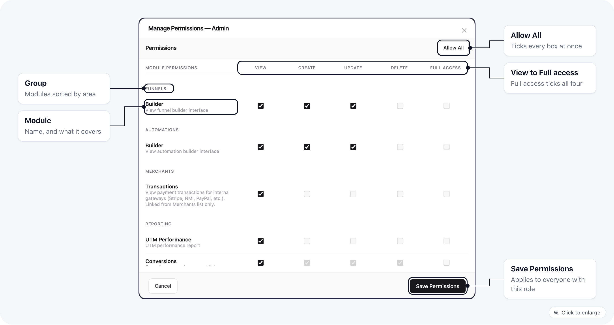
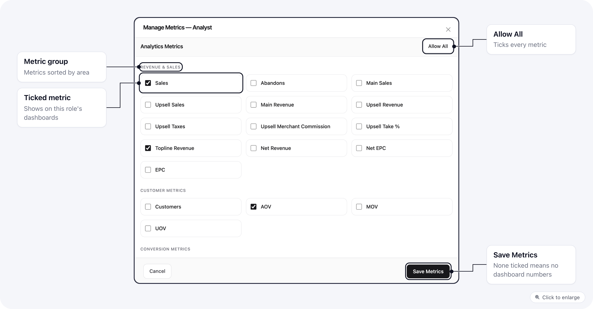

## Overview

ElasticFunnels uses **organization roles** to decide what each teammate can access. Owners manage roles under **Settings > Roles** ([Organization roles](/settings/organization-roles)) and give them to people under **Settings > Users** ([Organization users](/settings/organization-users)). A role has:

- **Permissions**: dotted keys such as `conversions.view`, `pages.update`, `customers.export`.
- **Metrics**: which analytics numbers they may see on the dashboard, cards, and metrics table.

Owners always have full access. Users **not** in an organization (standalone brands) are not restricted by these lists.

## How access is decided

Most areas of the app check more than one thing:

1. The user must belong to the brand or organization.
2. The brand must have the related **module** enabled.
3. The user's role must include the required **permission**.
4. For analytics widgets, the user's role must also include the required **metrics**.

That means a user can sometimes:

- see a module in the brand setup, but not in the sidebar
- open a report section, but not every child page inside it
- have access to a feature, but still see no dashboard metrics

## What permissions affect

- **Sidebar and navigation**: Menu entries check both permissions and related modules.
- **Screens and actions**: Buttons, create flows, update actions, and exports can be restricted separately.
- **Reports**: The **Reports** section contains several child pages. You only see the report pages your role allows. Clicking **Reports** opens the **first report child you are allowed to access**.
- **Dashboard analytics**: Metrics, cards, and the metrics table are controlled by metric access, not only by feature permissions.

## Metrics vs permissions

Permissions control **features** (pages, conversions, settings, etc.). **Metrics** control **dashboard numbers** (sales, revenue, cards, breakdown tables).

If your role has **no metrics** assigned, the dashboard will **not** show:

- the main metrics grid
- metric cards
- the main metrics table

You may still be able to use reports, conversions, customers, pages, or settings if your feature permissions allow them.

## Common examples

### Reports behavior

If a user only has access to one report child, such as **Customers** or **Conversions**, the sidebar still shows **Reports**, and clicking it opens the first report page that user can actually access.

### Customers and conversions

- **Customers**: Viewing the Customers report requires `customers.view`. Export uses `customers.export`. Creating a manual customer order (which creates a purchase conversion) requires **`conversions.create`** in addition to appropriate customer access where applicable.
- **Fulfillment**: Viewing the fulfillment list is tied to **conversions** access. Seeing or configuring **integrations** is separate (`integrations.view`). You can have fulfillment orders listed even if you cannot open the Integrations screen.

{/* BILLING SECTION START: adjust after the billing permissions fix (T1106-3) is deployed. */}

### Billing

The Admin role does not include Billing. To give someone Billing, tick the **Billing** rows in their role (Invoices, Payment Cards, Plan), or **Organization > Settings**, which also opens the organization Settings page and Affiliate Portal. The exact boxes are in [Give someone Billing](/settings/organization-roles#give-someone-billing).

{/* BILLING SECTION END */}

### Affiliate portal

The organization's affiliate portal has its own group in the role editor, **Affiliate portal**, with one row per part of the portal: Portal settings, Portal affiliates, Payouts and billing, Assets and Commission groups. Give a role only the rows it needs. Someone who handles payouts can get **Payouts and billing** without being able to change the portal's domain or branding, and the portal opens on the tabs their role has.

Organization settings permissions no longer open the portal on their own. When this group was added, roles that could change organization settings were given every portal permission, and roles that could view them were given every view.

To let someone add an internal affiliate on a brand, give their role **Use portal affiliates in brands** as well as **Affiliates** create or update.

## How to set up a restricted role

For a practical setup flow:

1. Create a role under **Settings > Roles**, or start from an existing role that is close to the access level you want.
2. In **Manage Permissions**, tick only the rows and actions the user needs.
3. In **Manage Metrics**, tick only the numbers the user should see.
4. Test with a real restricted user account before assigning the role broadly.

[Organization roles](/settings/organization-roles#worked-examples) has worked examples for finance, support, fulfillment and media buyers.

## Tips for admins

1. Start from a template role close to what you need, then remove permissions.
2. If someone sees a menu item but gets errors loading data, check both **permissions** and **module** toggles for the brand.
3. Set **metrics** explicitly for restricted roles; an empty metric list means **no** dashboard metrics.
4. Treat view, export, create, and update as separate capabilities. In some areas, being able to see a list does not mean the user can export or create.

## Next steps

- [Organization roles](/settings/organization-roles): built-in roles, creating a role, the permissions grid and worked examples.
- [Organization users](/settings/organization-users): inviting people and choosing their brands.
- Use the [Permission Matrix](/essentials/permission-matrix) to map common capabilities to permission keys.
- Use [Restricted Role Troubleshooting](/essentials/restricted-role-troubleshooting) for setup examples and debugging steps.
