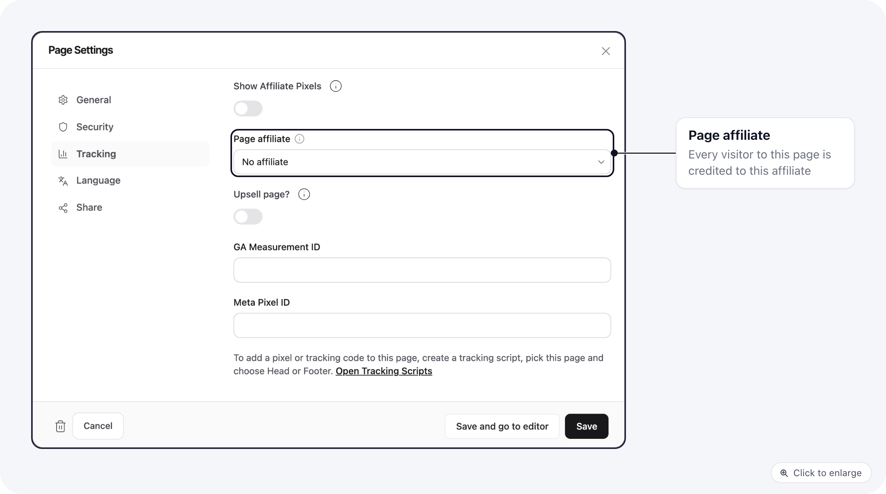

When several agencies or affiliates send traffic to the same offer, you don't need a copy of the funnel, checkout and upsells for each. Keep one funnel. Give each partner their own sales pages as entry points. The checkout and upsells stay shared, so a change happens in one place.

## How it fits together

| You want | Use |
|----------|-----|
| Many sales pages leading into one funnel | One **page group** connected to the funnel's entry, holding every sales page. See [Trigger pages](/funnels/trigger-pages). |
| The funnel to run on those pages | A trigger rule on **Starting page** with **is one of**. See [Trigger rules](/funnels/trigger-rules). |
| One checkout, changed in one place | A **Set checkout page** node after the page group. |
| Each page credited to one partner | **Page affiliate**, below. |
| Each partner's pixel on every step | A tracking script (**Pages > Tracking Scripts**) with that partner as its **Affiliate**, on all pages. |
| Each partner's Meta server events | Their Meta Pixel ID and access token on the affiliate. |

## Tie a page to an affiliate

1. Create the partner under **Affiliates** if they don't exist yet.
2. In **Pages**, open the page's menu and choose **Settings**.
3. Open **Tracking** and pick the partner in **Page affiliate**.
4. Save.

<Frame>
  
</Frame>

What happens once it is set:

- Every visitor who lands on the page is credited to that affiliate. The ad link needs no affiliate parameter.
- It replaces any affiliate in the link, or one left from an earlier visit. A visitor who later lands on another partner's page moves to that partner.
- The affiliate stays with the visitor through the following pages, the checkout and the upsells, so that partner's tracking scripts keep firing on those steps.
- Sub IDs and UTM parameters in the link still count.
- Page versions use the same affiliate as the main page.

<Note>
Page affiliate works on domains that use your own checkout, such as Stripe or NMI, and needs a merchant on the domain. On ClickBank, BuyGoods and other merchants that track their own affiliates, the setting is ignored.
</Note>

## Publish from your own page editor

If you edit pages in your own tool, it can publish through the [API](/api-reference/authentication) so nobody has to open ElasticFunnels.

1. **Copy a page for a new version:** `POST /api/brands/{brand}/pages/{page}/clone` with `title` and `slug`. The response holds the new page's `id`.
2. **Update the content:** `POST /api/brands/{brand}/pages/{page}/editor` with `html` and `draft: false`. This goes live immediately. Send `expected_revision_id` to avoid overwriting a change someone made in the meantime.
3. **Add it to the funnel and credit the partner:** `POST /api/brands/{brand}/funnels/{funnel}/entry-pages` with `page_id` and `affiliate_id`. See [Funnels API](/api-reference/endpoints/funnels#add-an-entry-page).
4. **Get the link to run:** `GET /api/brands/{brand}/pages/{page}/editor/live-url`.
5. **Undo a bad publish:** `GET /api/brands/{brand}/pages/{page}/revisions`, then `POST /api/brands/{brand}/pages/{page}/revisions/{revision}/restore-to-current`.

Keep these in mind when you build it:

- **An API key opens the whole brand.** Keep it on your server, never in browser code, and have your server decide which pages each partner may touch.
- **Let partners edit set fields**, such as headline, video and colors, in a template you control. Raw HTML from a partner can break buy links and tracking.
- **Publishing is live on your domain right away.** If claims need checking, approve the change in your tool before you call the API.
- **A draft page is still public at its URL.** Only the `offline` status hides a page.
