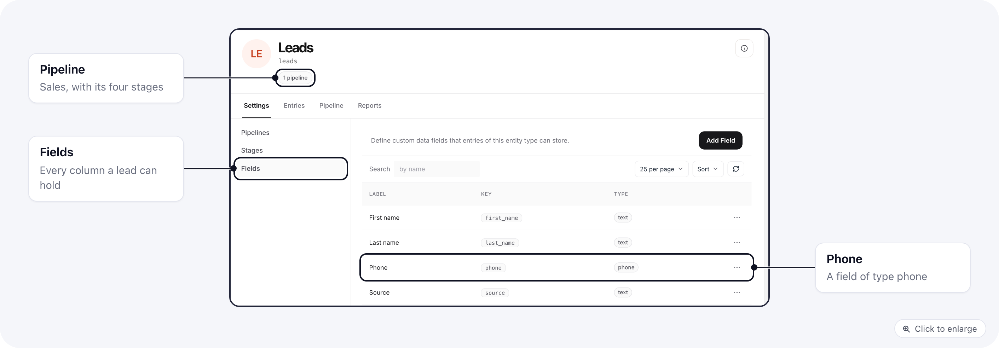
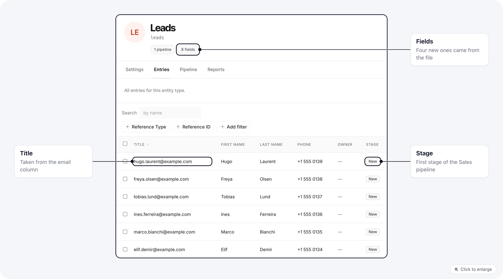
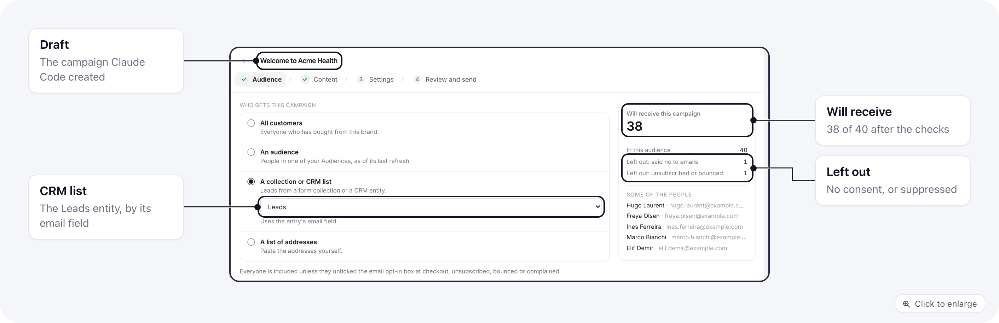
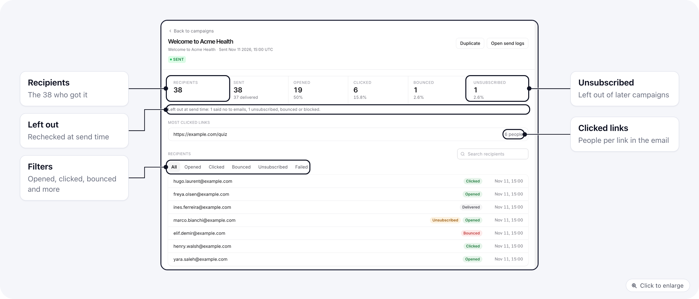

This guide builds a contact list in the ElasticFunnels CRM and emails it, without leaving Claude Code. You ask in
plain language, Claude Code runs the `ef` commands, and you approve the send. Each step below shows the prompt and
the commands it runs, so you can also type them yourself.

Watch the walk-through: [Build your own CRM with Claude Code](https://elasticfunnels.io/academy/build-crm-with-claude-code).

## Before you start

- **The ef CLI 0.28.4 or later, connected to your project.** Install it with `npm i -g @elasticfunnels/cli@latest`
  and check the version with `ef --version`. Then run `ef init` in an empty folder and approve the connection in your
  browser. The full walk-through is [Connect the ef CLI](/account/cli-and-api-keys).
- **Claude Code, opened in that folder.** `ef init` also runs `ef claude`, which installs the `ef-crm`, `ef-campaigns`
  and `ef-segql` skills into `.claude/skills/`. They tell Claude Code how to build a CRM and import into it, how
  to build audiences, and how to send safely.
  Run `ef claude` again if you set the folder up with `--no-claude`.
- **A sending account** for campaigns (Amazon SES, Postmark, Brevo, Resend, Mailgun, SendGrid, Mailrelay or your
  own SMTP). See [Before your first campaign](/campaigns/email-campaigns#before-your-first-campaign).
- **Permissions:** the CRM permissions to create entities and fields, and the email permissions to create and
  send campaigns. The CLI acts with the permissions of the person who approved it.

```bash
npm i -g @elasticfunnels/cli@latest
ef --version
mkdir acme-health && cd acme-health
ef init
claude
```

## 1. Create a CRM entity and its fields

An entity is a type of record in the CRM, such as Leads, and its fields are the columns each record has. An entity
in CRM mode also has pipelines, the stages a record moves through. The full model is in the
[CRM overview](/crm/overview).

Ask Claude Code:

```text
Make me a Leads CRM in ElasticFunnels: first name, last name, phone and source,
and a pipeline: New, Contacted, Qualified, Customer.
```

It runs:

```bash
ef crm entities create --name "Leads" --slug leads --singular "Lead" --plural "Leads" --entity-mode crm
ef crm fields create leads --label "First name" --key first_name --type text
ef crm fields create leads --label "Last name" --key last_name --type text
ef crm fields create leads --label "Phone" --key phone --type phone
ef crm fields create leads --label "Source" --key source --type text
ef crm pipelines create leads --name "Sales" --default
ef crm stages create <pipeline-id> --name "New" --order 0
ef crm stages create <pipeline-id> --name "Contacted" --order 1
ef crm stages create <pipeline-id> --name "Qualified" --order 2
ef crm stages create <pipeline-id> --name "Customer" --order 3
```

`entities create` prints the new entity's number: `✓ Created CRM entity #120 (leads).` Keep it, because the campaign
in step 3 uses that number. `ef crm entities list` shows it again later. `pipelines create` prints the pipeline's
number, which the `stages create` lines use.



There is no email field yet. The import in step 2 creates it from the email column of your file, with the type
`email`. When a campaign goes to this entity, ElasticFunnels reads each address from the entity's email-type fields
(or from a field with the key `email` when there is none), and skips a record with no valid address.

Keep a **First name** field (key `first_name`) if your emails greet people by name. The merge tag
`{{ customer.first_name }}` takes its value from that field. Without one, it falls back to a field keyed `name` or
`full_name` and inserts the whole name, so the greeting reads "Hi Ann Lee". A full name is not split into first and
last, so give your file a first name column of its own.

The other field types are listed in `ef crm fields create --help` and in
[Supported field types](/crm/overview#supported-field-types).

## 2. Upload contacts from a CSV or Excel file

Put your list in a `.csv`, `.tsv`, `.txt` or `.xlsx` file with the column names in the first row. An Excel file
is read from its first sheet only; save old `.xls` files and Numbers files as `.xlsx` or `.csv` first. One file
can hold up to 20 MB and 20,000 rows, so split a bigger list.

Ask Claude Code:

```text
Import leads.csv into Leads. Show me the plan first.
```

The `ef-crm` skill, installed by `ef claude` with the others, has Claude Code run the import in two passes: a
preview first, which it shows you, and the real import only after you agree.

### Preview the plan

```bash
ef crm import leads --file leads.csv --preview
```

The preview reads the file and writes nothing. It prints the number of rows and columns, then one line per
column: its **action**, the field it goes to, the field type and a few sample values.

```text
leads.csv: 40 rows, 8 columns.
#  column       action    field        type         samples
-  -----------  --------  -----------  -----------  --------------------------------------------------
0  first_name   existing  first_name   (existing)   Maya | Daniel | Priya
1  last_name    existing  last_name    (existing)   Chen | Okafor | Raman
2  email        create    email        email        maya.chen@example.com | daniel.okafor@example.com
3  phone        existing  phone        (existing)   +1 555 0100 | +1 555 0101 | +1 555 0102
4  source       existing  source       (existing)   Quiz | Webinar | Facebook ad
5  status       create    status       select       New | Contacted | Qualified
6  signup_date  create    signup_date  date         2026-10-01 | 2026-10-08 | 2026-10-15
7  tags         create    tags         multiselect  webinar,ebook | quiz | ebook
Title from: email; pipeline #121, stage #190. New fields: email (email), status (select), signup_date (date), tags (multiselect).
Preview only: nothing was written. Drop --preview to import (add --map / --skip to change the plan).
```

| Action | What happens to the column |
|---|---|
| `existing` | Its header matches the key or label of a field the entity already has, so values go there |
| `create` | A new field is made for it, with a key from the header and a type suggested from the values |
| `skip` | Left out: the column is empty, or you skipped it |

Read the **type** of every `create` line and change what you disagree with before you import. Under the table,
**Title from** names the column used as each record's title, then the pipeline and stage the records go to, and
**New fields** lists the fields the import would create.

Check the email column before you go on, because the campaign in step 3 reads the address from the entity's
email field. It has to show `existing` on an email field, or `create` with the type `email`. When the header is
something else, or a type is wrong, map it yourself:

```bash
ef crm import leads --file leads.csv --preview --map "E-mail Address=email:email" --skip Notes
```

- `--map "Column=key[:type]"` sends a column (its header, or its position counting from 0) to a field key. A key
  the entity does not have yet is created with the suggested type, or with the type after the colon: text,
  textarea, email, phone, url, number, date, datetime, boolean, select or multiselect. Repeat it for more columns.
- A tag column becomes a `multiselect` field when its values look like lists. If it is not detected as one,
  `--map "Tags=tags:multiselect"` forces it.
- `--skip <column>` leaves a column out. Repeatable.
- `--title <column>` picks the column used as each record's title.
- `--pipeline <id>` and `--stage <id>` pick where the records go in an entity in CRM mode. Without them, records go
  to the first stage of the default pipeline: **New** in the Sales pipeline here.

Run the preview again after each change until the plan is right.

### Import

```bash
ef crm import leads --file leads.csv --yes
```

Pass the same `--map`, `--skip` and `--title` flags you used in the preview. The import first creates the new
fields (`Created field email (email).` for each), then sends the rows in batches of up to 250 (`--batch` sets a
smaller size) and prints a line per batch. It ends with a summary:

```text
✓ Imported 40 entries into leads (0 skipped, 0 failed).
```

When rows fail, the first 20 follow with their line number and the reason. `--json` prints the whole result,
every error included.

Without `--yes`, the command asks for confirmation in a terminal. Where there is no terminal to ask in, as when
Claude Code runs it, it stops instead, so Claude Code adds `--yes` once you have approved the plan.

<Warning>
A plain re-import adds the rows again. To update the people already in the entity instead, merge on the email:

```bash
ef crm import leads --file leads.csv --upsert-by email --yes
```

A row whose email matches a record (upper and lower case count as the same) updates that record: a filled cell
overwrites the old value, an empty cell keeps it, and tags are combined. Rows with a new email are added.
If a run stops partway, it prints the row to resume from; run the same command with `--offset <n>`, and the rows
before it are not imported again.
</Warning>

Imported records do not trigger stage automations or form webhooks. They show up in **Apps → CRM** under the
entity, like records added by hand.



## 3. Send an email campaign to the list

### Write the email

Ask Claude Code for the email itself as an HTML file, and say who it is from:

```text
Write a short welcome email for the Leads in welcome.html: greet them with {{ customer.first_name }},
two lines about Acme Health, a button to https://example.com/quiz.
Send it from Acme Health, hello@example.com.
```

Claude Code writes the HTML into the folder; the campaign reads it with `--html-file` in the next step.
`{{ customer.first_name }}` is filled from each lead's First name field when the email is sent.

ElasticFunnels adds the footer with the unsubscribe link and your postal address to every campaign email when it
is sent, so the HTML only needs the message. See [The footer and unsubscribe link](/campaigns/email-campaigns#the-footer-and-unsubscribe-link).

### Create the campaign for the CRM list

```bash
ef campaigns email create --name "Welcome to Acme Health" --subject "Welcome to Acme Health" \
  --from-name "Acme Health" --from-email hello@example.com \
  --crm-entity 120 --html-file welcome.html
```

`--crm-entity` takes the entity number from step 1. The command prints `✓ Created draft email campaign #35.` and
then lists anything that would still block sending, such as a missing subject or sending account
(`--integration <id>` picks the sending account). `ef campaigns email get 35` shows the same list later. To change
the email of a draft, run `ef campaigns email set 35 --html-file welcome.html`.

<Accordion title="Send to a saved audience instead">
A campaign can also go to a saved audience: people picked by what they did, written as a SegQL query. Ask Claude
Code something like "email everyone who bought twice in the last year", and it writes and checks the query with
the `ef-segql` skill:

```bash
ef audiences count --segql 'FROM conversions WHERE COUNT order() >= 2 WITHIN 365d IDENTIFY BY email'
ef audiences create --name "Repeat buyers 12m" \
  --segql 'FROM conversions WHERE COUNT order() >= 2 WITHIN 365d IDENTIFY BY email'
ef campaigns email create --name "Repeat buyers thank you" --subject "A thank you from Acme Health" \
  --from-name "Acme Health" --from-email hello@example.com --audience 42 --html-file email.html
```

`--audience` takes the number `audiences create` printed. More on audiences:
[Audiences and campaigns from the ef CLI](/account/cli-audiences-and-campaigns).
</Accordion>

### Count who will receive it

```bash
ef campaigns email count 35
```

`count` is short for `audience-preview`. It prints one line, then a few sample addresses:

```text
✓ 38 will receive it (of 40; excluded: 1 suppressed, 1 without consent, 0 duplicates)
```

The excluded counts are addresses on your
[suppression list](/campaigns/email-campaigns#suppression-list) (bounced, complained, unsubscribed), people who
said no to emails at opt-in, and duplicates (the same address in two records counts once). The sample addresses
come back masked unless your role can see contact details unmasked. The same count is on the draft's Audience step
in the app:



### Send a test to yourself

```bash
ef campaigns email test 35 --to alex@example.com
```

It prints `✓ Test sent to alex@example.com via mailgun.`, naming the service it went through. Without `--to`, the test goes
to the address of the account that connected the CLI. The test is the real email, footer included, and it never
goes to the list. You can send 10 tests per campaign per hour.

### Schedule or launch

```bash
ef campaigns email schedule 35 --at 2026-12-01T15:00:00Z
ef campaigns email launch 35
```

Both print the number of people who will receive it and then stop to ask. In a terminal you type the confirmation;
from Claude Code the command stops until it is run again with `--yes`, and the `ef-campaigns` skill tells Claude
Code to show you the count, the subject and the time and to add `--yes` only after you say go.

The send is also refused while no test was sent. `--skip-test` overrides that and sends without a test; leave it
out unless you have already checked the email another way. A schedule has to be more than a minute ahead, and
`ef campaigns email unschedule 35` turns a scheduled campaign back into a draft. `cancel` stops one that is
scheduled or already sending, but emails already sent stay sent.

### Read the results

```bash
ef campaigns email stats 35
ef campaigns email recipients 35
```

`stats` shows recipients, sent, delivered, failed, bounced, opened, clicked, unsubscribed and complaints.
`recipients` lists each address and what happened to it. Opens and clicks are counted only when your sending
account reports them back; see
[Delivery stats](/campaigns/email-campaigns#delivery-stats-and-the-campaign-settings-page). The same report is in
the app under **Campaigns**: [The report](/campaigns/email-campaigns#the-report).



## Related

- [CRM overview](/crm/overview): entities, fields, pipelines and entries in depth.
- [Contacts](/contacts/overview): one record per person in your brand, matched from orders, abandoned checkouts and form fills.
  [Importing Contacts](/contacts/import) adds a CSV to that Contacts list with each person's consent; it does not
  fill a CRM entity.
- [Email campaigns](/campaigns/email-campaigns): the same campaign in the app, step by step.
- [Audiences and campaigns from the ef CLI](/account/cli-audiences-and-campaigns): every audience and campaign
  command, SMS included.
