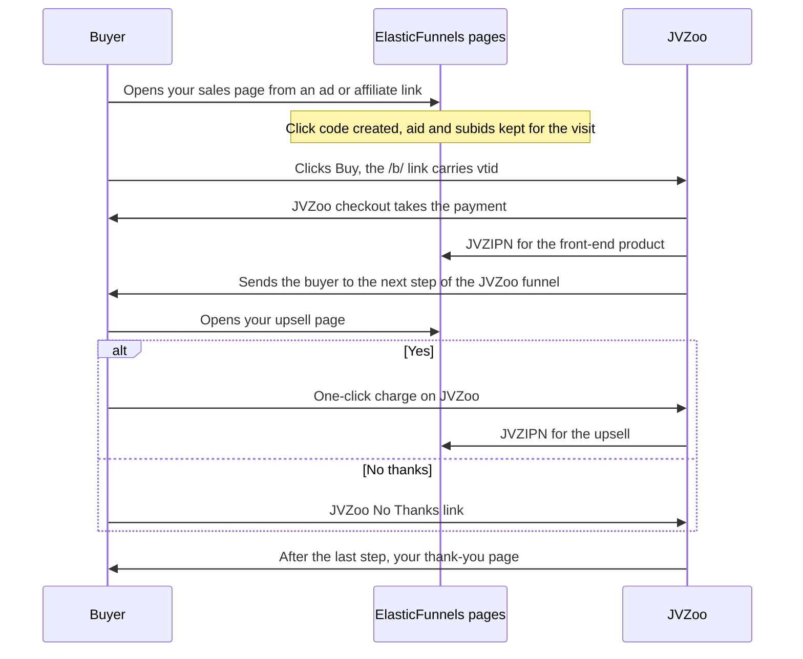

JVZoo is a hosted checkout. Your funnel owns the sales pages, and buyers leave them for a JVZoo buy link where JVZoo takes the payment and runs its own upsell sequence. ElasticFunnels builds those buy links for you, then records each order when JVZoo reports it back over JVZIPN.

<Note>
**This page is for vending your own products on JVZoo.** Promoting other sellers' JVZoo products is the separate [JVZoo Affiliate S2S integration](/integrations/jvzoo#jvzoo-affiliate-s2s).

The two use different tracking parameters: `vtid` carries your click code on your own buy links, `tid` is the affiliate's SubID. ElasticFunnels never writes to `tid` on a vendor buy link, so an affiliate's own sub-tracking passes through untouched.
</Note>

## How a JVZoo purchase flows

Your pages live on ElasticFunnels. The checkout, the upsell charges and the order sequence live on JVZoo. A buyer moves between the two like this:



| Step | Where it happens | What you set up |
| --- | --- | --- |
| 1. The visitor lands on your sales page | ElasticFunnels | Your page on an ElasticFunnels domain. Affiliate traffic carries `aid` only with **Pass Affiliate ID to sales page** on in JVZoo ([Affiliate attribution](#affiliate-attribution)). ElasticFunnels creates the click code and keeps `aid` and the subids for the visit. |
| 2. The buyer clicks Buy | ElasticFunnels page, link to JVZoo | A `[BUY=...]` tag or a pasted `/b/` link. Both reach JVZoo with `vtid=<click code>`; the tag also adds the affiliate ID ([Buy links](#buy-links)). |
| 3. Payment | JVZoo checkout | Nothing in ElasticFunnels. JVZoo hosts the checkout and charges the card. |
| 4. Next step of the funnel | JVZoo sends the buyer to your page | The order of products in JVZoo's **Funnel Builder**, and each product's **Sales Page URL** (General Information tab) pointing at your ElasticFunnels upsell page. Parameters ride along only with **Allow Parameter Passthrough** on. |
| 5. Yes or No on the upsell | Your page, charge on JVZoo | Yes: a `[UPSELL=...]` tag or pasted `/b/` link, charged in one click when **One Click Upsell** is on, plus JVZoo's one-click script in the page head ([scripts](#the-one-click-upsell-script-and-the-affiliate-link-script)). No: JVZoo's No Thanks link ([Upsell pages](#upsell-pages)). |
| 6. Thank-you page | JVZoo sends the buyer to your page | **Thank You / Download Page** on each product's Product Access tab ([Thank-you page](#thank-you-page)). |
| 7. Orders recorded | JVZoo to ElasticFunnels | The ElasticFunnels JVZIPN URL on every product (Step 4). Each product bought sends its own JVZIPN, so the front end and each upsell become separate order lines. Refunds and chargebacks arrive the same way later. |
| 8. Attribution | ElasticFunnels | Nothing extra. The order, amount, products and affiliate are recorded, and the sale is linked to its visit, ad and split test through the `vtid` JVZoo sends back ([what is attributed](#buy-links)). |

ElasticFunnels never sees the card and never decides which upsell comes next. JVZoo does both.

## What you need

- A JVZoo seller account with your products added, and a JVZoo funnel that chains them (front end, then each upsell and downsell)
- Your pages on an ElasticFunnels domain
- About 20 minutes

Build the funnel itself in JVZoo under **Sellers** → **Manage Funnels**. Upsells are charged by JVZoo, so the upsell order lives there, not in ElasticFunnels. Open the funnel, click **Funnel Settings**, and turn on **One Click Upsell** (so buyers are not asked for their card again) and **Allow Parameter Passthrough** (so the parameters on your buy links reach the next step). Set the order of the upsells and downsells under **Funnel Builder**.


## The three numbers of a JVZoo buy link

Everything ElasticFunnels needs from JVZoo is in the buy link JVZoo generates for your product:

```
https://www.jvzoo.com/b/120456/451020/99
                        ^       ^      ^
                        funnel  product button
```

| Part | What it is | Where it goes in ElasticFunnels |
| --- | --- | --- |
| `120456` | Your JVZoo funnel ID. JVZIPN reports it as `funnel_id`. | **JVZoo Funnel ID** on the merchant (Step 1) |
| `451020` | The product ID. Each product in the funnel has its own. | **jvzoo Product ID** on the product (Step 2) |
| `99` | The button ID | **JVZoo Button ID** on the funnel's domain row (Step 3) |

To get the link: in JVZoo, open **Sellers** → **Seller Dashboard**, click the **⋮** menu next to a product and pick **Buy Buttons**.


Choose your funnel at the top (not "No Funnel") and scroll to **USE YOUR OWN BUTTON!**. **Step 2: Checkout Page Link** is the buy link. Do this for every product in the funnel: the first and third numbers stay the same, the middle number changes per product.


The button ID is `99` for **USE YOUR OWN BUTTON!**, which is what you want on ElasticFunnels pages, since your page draws its own button. JVZoo's ready-made button designs further down use `1` to `15`. It is always a number: a code with letters (for example from an affiliate link or a coupon) is not a button ID.

<Warning>
The **first** number is the funnel ID, not the last one. The last number (often `99`) is the button ID and goes on the funnel's domain row. Your JVZoo **vendor ID** or **affiliate ID** (the account number on your JVZoo profile) goes nowhere in this setup. Either one typed into **JVZoo Funnel ID** produces buy links and a pixel that JVZoo does not recognise.
</Warning>

## Step 1: Create the JVZoo merchant

1. Go to **Settings** → **Merchants** and click **Create Merchant**
2. Pick **JVZoo** as the **Gateway**, type a **Name**, and click **Create & Configure**. A guided setup opens: it asks for the fields below on **Account details**, then the product IDs (Step 2), the JVZIPN URL (Step 4) and a live test (Step 5), and resumes where you left off (**Continue setup** on the merchant's row). In the merchant's full editor (**Open full editor**) the same fields are on **General information**.


3. **JVZoo Funnel ID**: the first number of your buy link (`120456` above)
4. **JVZIPN Secret Key (optional)**: your JVZoo secret key (see below). Postbacks are recorded without it until you add it.
5. Click **Save and continue**. **Products** opens next.


Your secret key is on your JVZoo account, not on a product: open **My Account** → **Account Details**, and under **Seller Settings** click **Edit Information**. The key is the **JVZIPN code** field. If it is empty, type a code of your own or click **Generate New**, then click **Save Information** at the bottom of the page. Copy the same value into ElasticFunnels as it is.


<Warning>
**Generate New** in JVZoo replaces the key. Every JVZIPN after that is signed with the new key, so paste the new one into the merchant straight away, or keep **Accept postbacks without verifying the key** on until you do.
</Warning>

**Accept postbacks without verifying the key** is on by default. While it is on, JVZIPNs are recorded even with no key or a key that does not match, so no order is lost while you set things up. Once the key is in and sales arrive, turn it off: from then on a JVZIPN without a valid signature is refused (`400 missing secret` with no key, `401 invalid signature` with a wrong one) and nothing is recorded for it.

## Step 2: Map each JVZoo product ID

1. Go to **Settings** → **Products** and open the product
2. On the **Merchants** tab, fill **jvzoo (&lt;funnel ID&gt;) Product ID** with the middle number of its buy link (`451020` above)
3. Save, then repeat for every product in the funnel, upsells and downsells included


The same ID builds the buy link and matches incoming JVZIPNs to the product. With no mapping, the product's own **Code** is used, which only works if the code is the JVZoo number.

## Step 3: Assign the domain and the button ID

First point the domain at the merchant:

1. Go to **Settings** → **Domains**, open the domain's menu and click **Edit**
2. Pick your JVZoo merchant under **Merchant** and **Save**


Every `[BUY=...]` and `[UPSELL=...]` tag on a page of this domain now builds a JVZoo buy link.

Then give the funnel the button ID:

1. Go to **Funnels**, open the funnel that holds your pages and click **Edit**
2. Under **Domains**, on the row of your JVZoo domain, type the **third** number of the buy link (`99` above) into **JVZoo Button ID**
3. Save


You do not rebuild JVZoo's upsell order in ElasticFunnels. The ElasticFunnels funnel is only where the button ID lives: one funnel served on two domains can use two different JVZoo buttons. The field is required on a JVZoo domain when you save the funnel. A page that is not in a funnel, or an older funnel saved without it, gets buy links with two numbers and a trailing slash (`/b/120456/451020/`); add the button ID so they match JVZoo's own links.

## Step 4: Paste the JVZIPN URL into every JVZoo product

1. In the guided setup, this is the **Postback URL** step. Later, in **Settings** → **Merchants**, click **Postback Setup** on the JVZoo merchant's row (or **Copy Postback URL** in its row menu). Its steps are listed on the left: **Postback URL**, **Set up in JVZoo** and **Test**.
2. Copy **Your Postback URL**. It has the form `https://app.elasticfunnels.io/postback/vendor/<code>/jvzoo`, where `<code>` belongs to this merchant.


3. In JVZoo, open the product's editor from **Sellers** → **Seller Dashboard** (click the product, then **Edit**) and go to the **Advanced** tab


4. Tick **JVZIPN v1 / JVZIPN v2 / KeyGen / External Program**
5. Paste the URL into **JVZIPNv2 URL(s)**. If that box already holds your own delivery or CRM script, paste it into **JVZIPNv1 URL(s)** instead: ElasticFunnels reads both versions.
6. Save the product
7. Repeat for **every product in the funnel**: the front end and each upsell and downsell. JVZoo sends one JVZIPN per product, so a product without the URL sends its sales nowhere. The URL is the same for all of them; the product ID inside each JVZIPN tells them apart.


<Warning>
Not the **Server to Server Postback** on your JVZoo account page (**My Account** → **Account Details** → **Affiliate Settings**). That one reports commissions you earn promoting other sellers' products, and never fires for products you sell.
</Warning>

Sales, rebills, refunds, chargebacks, subscription cancels and reactivations, and abandoned orders all arrive at this one URL.

<Note>
Use the merchant's URL, not the **JVZoo Vendor IPN** integration's. The merchant matches each order to your products, links refunds and chargebacks to the original sale, removes duplicate notifications when **Deduplicate Orders** is on, and records the affiliate. The JVZoo Vendor IPN integration under Integrations is a separate, simpler receiver that stores the product name only. See [JVZoo Vendor IPN](/integrations/jvzoo#jvzoo-vendor-ipn).
</Note>

## Step 5: Test the connection

The merchant shows **Needs Setup** until its first JVZIPN arrives. JVZoo has no button that sends a test notification, so the **Test** step of Postback Setup can time out while it waits; that does not mean anything is wrong.

1. In JVZoo, click the **⋮** menu next to the front-end product and pick **Create a Test Purchase**, then complete the order
2. The first JVZIPN that reaches ElasticFunnels marks the merchant **Verified**, even after the Postback Setup window has closed. A real sale does the same.
3. Check the order under **Reports** → **Conversions**, and the raw notification under **Settings** → **Logs** → **Merchant Postbacks**

**Create a Test Purchase** covers one product. To go through the upsells and the thank-you page as a buyer does, open the funnel under **Sellers** → **Manage Funnels** and click **Activate Test Purchase Mode for this Funnel**, then buy from your live front-end page. Turn test mode off again when you are done. You can also run a real order through the whole funnel and refund it.


## Buy links

Use the standard tag on your sales page:

```html
<a href="[BUY=sleep-gummies-1]">Buy Now</a>
```

With the merchant, the product mapping and the domain row set, it becomes:

```
https://www.jvzoo.com/b/120456/451020/99?vtid=<click_code>&aff=<affiliate_id>&aid=<affiliate_id>
```

| Part | Source |
| --- | --- |
| `120456` | Merchant **JVZoo Funnel ID** |
| `451020` | The product's **jvzoo Product ID** |
| `99` | **JVZoo Button ID** on the funnel's domain row |
| `vtid` | The visitor's ElasticFunnels click code |
| `aff`, `aid` | The JVZoo affiliate ID, when the visit came from an affiliate. `aid` is the name JVZoo's own link script uses; both carry the same value |

`subid`, `subid2` and `subid3` on the page URL are passed through, and the domain's **Buy Link Parameters** are added to every link.

<Note>
**What is attributed.** Orders, products, amounts, refunds, chargebacks and affiliates come from the JVZIPN and are always recorded. JVZoo also sends back the extra parameters of the buy link (`cvendthru` on JVZIPN v1, `other_params` on v2). ElasticFunnels reads `vtid` from them and links the sale to its visit, page, ad and split test. Sales recorded before 20 October 2026 were not linked.
</Note>

### Upsell pages

Upsell and downsell pages use `[UPSELL=code]` and `[DOWNSELL=code]`. On a JVZoo domain they build the JVZoo buy link for that product with the same click code. Map every upsell product's JVZoo ID (Step 2).

For the "No thanks" link, use JVZoo's own: `https://www.jvzoo.com/nothanks/<product ID>`, with the ID of the upsell the buyer is declining (for example `https://www.jvzoo.com/nothanks/451024`). JVZoo then sends the buyer to the next step of the JVZoo funnel. A plain link to your next page works too, but skips JVZoo's funnel order.

### Direct purchase links

A buy link copied from JVZoo (**Step 2: Checkout Page Link** on **Buy Buttons**) and pasted into the page needs nothing added. When the page renders, ElasticFunnels adds the visitor's click code as `vtid` to every `https://www.jvzoo.com/b/...` link in the page's HTML:

```html
<a href="https://www.jvzoo.com/b/120456/451024/99">Buy Now</a>
```

reaches the visitor as `https://www.jvzoo.com/b/120456/451024/99?vtid=<click_code>`.

- Other parameters on the link (`aff`, `aid`, `tid`) are kept.
- A `vtid` you set yourself is kept. A blank one (`vtid=`) or a placeholder (`{click_id}`, `{CLICK_ID}`, `[click_id]`) is replaced with the click code.
- JVZoo affiliate links (`/c/...`) are never changed.
- A link your page script builds by joining strings (`'https://www.jvzoo.com/b/1/2/3?tid=' + sub`) is left as it is, and a full stop or comma after a link in text stays outside it.
- To leave pasted links exactly as written, turn off **Add click tracking to pasted buy links** in the merchant's **Settings**. `[BUY=...]` tags still carry the click code. With it off, sales through pasted links are not matched to a visit.

Add the click code yourself only where ElasticFunnels never sees the link in the page's HTML: a link built by JavaScript in the browser, or a link made in a backend script. In JavaScript, put `{click_id}` in the page code (it is replaced at render) and use the value. In a backend script, use the template-engine syntax:

```
https://www.jvzoo.com/b/120456/451024/99?vtid={{ click_id }}
```

Prefer `[BUY=...]` tags where you can: they add the affiliate ID too and pick up the merchant, the product mapping and the domain row, and a pasted link is one more place to update when any of those change. See the note under [Buy links](#buy-links) for what is attributed today.

## Thank-you page

JVZoo sends the buyer to the thank-you page set on each product in JVZoo, not to a URL on the buy link. In the JVZoo product editor, open the **Product Access** tab. Under **Electronic Delivery**, turn on **Thank You / Download Page** and paste your page's address (for example `https://example.com/thank-you`). Turn on **Send Customer to Thank You Page** so JVZoo sends buyers to that page after checkout. Set it on the last upsell too: that is where buyers land after the final step.


The order itself is recorded from the JVZIPN, so the thank-you page does not need to carry any order data. When JVZoo adds `transaction_id`, `receipt` or `cbreceipt` to the URL, the page knows the visitor is a customer and can show the order number.

## Tracking pixel and JVZoo scripts

JVZoo's onboarding gives you up to three pieces of code for your pages. Each has its own place.

### The sales pixel

JVZoo asks for its tracking image once on each sales page. The quickest way: on the JVZoo merchant's settings, turn on **Create Tracking Pixels** and save. ElasticFunnels adds the JVZoo pixel as a tracking script on all pages, in the footer, once per merchant.

To add it by hand instead:

1. Go to **Pages** → **Tracking Scripts** and click **Create Tracking Script**
2. Under **Template**, pick **JVZoo**
3. Set **Placement** to **Footer** and save


```html

```

Nothing to fill in. The tokens resolve per page:

| Token | Resolves to |
| --- | --- |
| `{jvz_acc_id}` | The merchant's **JVZoo Funnel ID** |
| `{product_code_first}` | The JVZoo ID of the first buy button on the page |
| `{jvz_funnel_id}` | **JVZoo Button ID** on the funnel's domain row |
| `{product_codes_comma}` | Every product code on the page, comma-separated |

Use **Footer**: an image tag in the head ends the head early in the browser, and any head script after it is moved into the body. One pixel per page is enough; do not also paste JVZoo's image by hand.

### The one-click upsell script and the affiliate link script

JVZoo also gives you a one-click upsell script for the head of each upsell page, and affiliate managers may give you a link script that keeps the affiliate ID and tracking parameters on your buy links. Both must be in the page's `<head>`:

- On one page: the page's **Settings** → **Tracking** → **Custom Header Code**
- On several pages: **Pages** → **Tracking Scripts** → **Create Tracking Script**, **Placement** **Head**, and pick the pages

<Warning>
Do not paste a head script at the top of the page's code (or at the top of a `.ef` file, after its `efmeta` block). Page code renders inside `<body>`, so the script ends up in the body and JVZoo or the affiliate manager will report it missing. Check with your browser's **View source**: the script must sit before `</head>`.
</Warning>

Put the one-click script on **every** upsell page, not only the first: JVZoo's compliance review checks each one.

## Affiliate attribution

JVZoo only tells you which affiliate sent a visitor if you turn it on, **per product**:

1. In the JVZoo product editor, open the **Affiliates** tab
2. Tick **Pass Affiliate ID to sales page** and save
3. Repeat for every product in the funnel

JVZoo then adds `aid=<affiliate_id>` when it hands the visitor to your page. ElasticFunnels keeps it for the session and puts it on the buy link as `aff` and `aid`, and the JVZIPN brings the affiliate and commission back with the sale.


<Warning>
With this setting off, affiliate traffic arrives with no affiliate ID and those sales cannot be attributed afterwards.
</Warning>

## Pages for JVZoo's review

JVZoo's team reviews your sales and upsell pages before the funnel goes live, and again when they change. If the copy you run to your own traffic differs from what you submit, keep both on the same page with [visitor-based content](/pages/visitor-based-content): the reviewed version for everyone, the other one only for visitors who arrive with your whitelist parameter.

- Give JVZoo the plain page address, without the parameter.
- Put the parameter on your ad and affiliate links.
- A browser that once opened a link with the parameter stays whitelisted (until the expiry you set on the **Whitelist visitor** node; `0` means forever). Test the reviewed version in a private window.
- Upsell pages need the reviewed version too, including JVZoo's disclaimer footer.

## How orders are recorded

- **Verification:** the first JVZIPN for the merchant clears **Needs Setup**, whether it is a test purchase or a real sale.
- **Versions:** JVZIPN v1 and v2 are both read, from either box in JVZoo.
- **Upsells** arrive as their own JVZIPN, one per product, and are matched by the product ID.
- **Products:** a JVZIPN for a JVZoo product ID mapped on no product raises a **Create Missing Product** action, and the order is saved without that product line. The action suggests the product it most likely is, so you can link the ID to it or create a new product; either way the sales already saved without the product are recorded on it. See [Sales for a product code you have not set up](/essentials/brand-actions#sales-for-a-product-code-you-have-not-set-up).
- **Refunds and chargebacks** link to the original sale by JVZoo's transaction ID.
- **Duplicates:** with **Deduplicate Orders** on, a repeated JVZIPN for the same order is recorded once.
- **Wrong funnel:** a JVZIPN whose `funnel_id` does not match the merchant's **JVZoo Funnel ID** is still recorded and flagged, since a URL copied from another offer would otherwise pour that offer's orders in silently.
- Every JVZIPN received is listed under **Settings** → **Logs** → **Merchant Postbacks**.

## Troubleshooting

<AccordionGroup>
  <Accordion title="Do I need a funnel in ElasticFunnels?">
    Only to hold your pages. The upsell order lives in JVZoo's **Funnel Builder**, and ElasticFunnels does not change it. The ElasticFunnels funnel is where the **JVZoo Button ID** sits on the domain row (Step 3), so put the sales and upsell pages in one and fill that field.
  </Accordion>
  <Accordion title="Buy links go to the wrong JVZoo page">
    Compare the link on your page with the one JVZoo gives you under **Buy Buttons**. The merchant's **JVZoo Funnel ID** must be the first number (not `99`, not your vendor or affiliate ID), the product's **jvzoo Product ID** the middle one, and the domain row's **JVZoo Button ID** the third one (`99` for your own button, never a code with letters).
  </Accordion>
  <Accordion title="Upsells never run after the front-end sale">
    Copy the button from the JVZoo funnel (not "No Funnel"), so the first number is the funnel's ID. Check that **One Click Upsell** is on for the JVZoo funnel and that every upsell product has its JVZoo ID mapped.
  </Accordion>
  <Accordion title="The merchant still says Needs Setup">
    No JVZIPN has arrived yet. Check that the merchant's URL from **Postback Setup** is in a JVZIPN box of the product you bought, then place a test purchase. With **Accept postbacks without verifying the key** off, a missing or wrong secret key also refuses every JVZIPN.
  </Accordion>
  <Accordion title="Sales stopped showing up, but the merchant still says Verified">
    **Verified** is set by the first JVZIPN and does not turn off when notifications stop, so it cannot tell you that sales are flowing. Open **Settings** → **Logs** → **Merchant Postbacks** and look for the last JVZoo entry. If nothing arrived after a certain date, check that the merchant's URL is still in a JVZIPN box of every product in JVZoo. If entries arrive with an error code, click **Show Details** to read why they were refused.
  </Accordion>
  <Accordion title="Sales stopped after I changed something in JVZoo">
    If you clicked **Generate New** on your JVZIPN code, the key on the merchant no longer matches. Paste the new key into **JVZIPN Secret Key**, or turn **Accept postbacks without verifying the key** on while you do.
  </Accordion>
  <Accordion title="Front-end sales arrive, upsell sales do not">
    The JVZIPN URL is set on the front-end product only. JVZoo sends one JVZIPN per product, so paste the same URL into every upsell and downsell product.
  </Accordion>
  <Accordion title="Sales arrive without a product">
    The JVZoo product ID is not mapped on any product. Open the **Create Missing Product** action and choose **Link to existing product** (it suggests the matching product) or **Create new product**. You can also fill **jvzoo Product ID** on the product's Merchants tab yourself.
  </Accordion>
  <Accordion title="JVZoo sales show no page, ad or split test">
    The buy link the buyer clicked had no `vtid`. Check that it is a `[BUY=...]` tag or a pasted `/b/` link in the page's HTML (a link built by your own script needs `{click_id}` added yourself), and that **Add click tracking to pasted buy links** is on in the merchant's **Settings**. Sales recorded before 20 October 2026 were never linked. The order, amount and affiliate are recorded either way. See [Buy links](#buy-links).
  </Accordion>
  <Accordion title="My tracker shows more sales than ElasticFunnels">
    ElasticFunnels records what JVZoo reports over JVZIPN, so it should match JVZoo's own sales report for the same products and dates. If a tracker such as ClickFlare shows more, check whether it counts each upsell as a separate conversion, and compare product by product.
  </Accordion>
  <Accordion title="Affiliate sales recorded with no affiliate">
    **Pass Affiliate ID to sales page** is off on that product's **Affiliates** tab in JVZoo, so no `aid` reached your page.
  </Accordion>
  <Accordion title="JVZoo says a script is missing from the head">
    The script was pasted into the page's code, which renders into the body. Move it to **Custom Header Code** or a **Head** tracking script and check **View source**.
  </Accordion>
  <Accordion title="Pixel renders with an empty product ID">
    `{product_code_first}` reads the buy tags on the page. A page with no `[BUY=...]` or `[UPSELL=...]` tag has no product to report.
  </Accordion>
</AccordionGroup>
