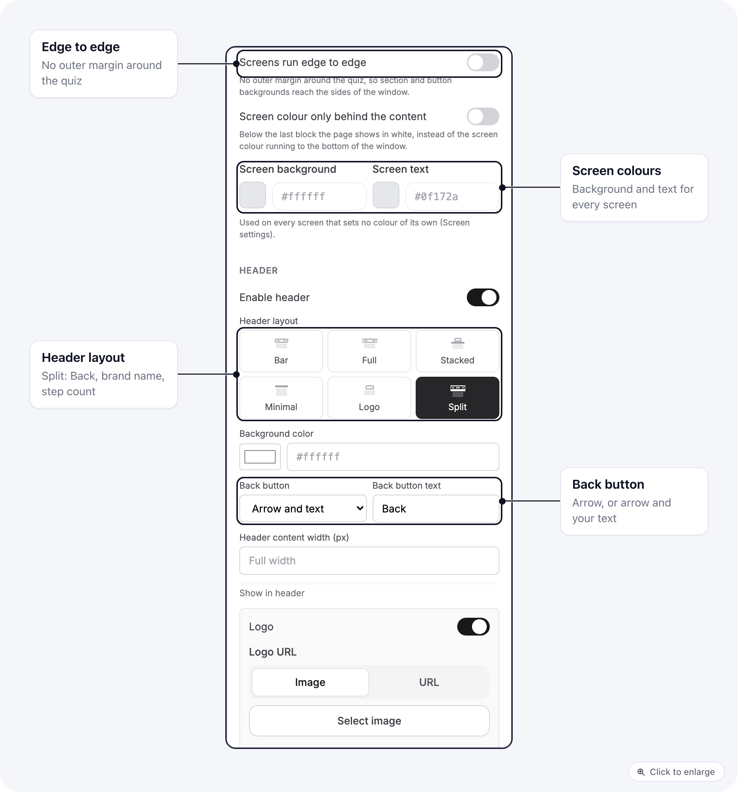
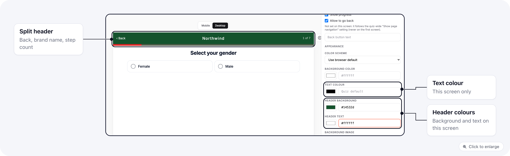
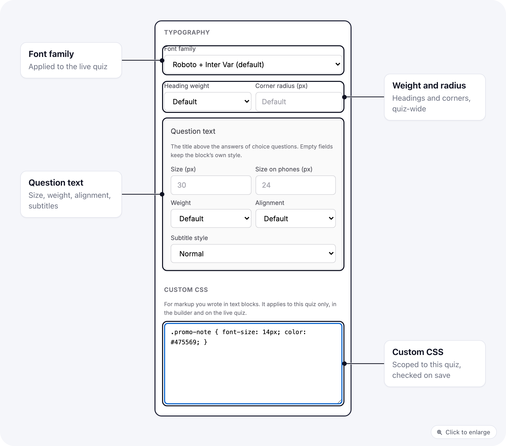

Everything about how a quiz looks is set in the quiz builder. The header, colours, answer styles and fonts you pick there draw the same way on the builder canvas and on the live quiz, so you do not need a styled page around the quiz to get the look you want. To build the questions and flow, see [Build and publish a quiz](/quizzes/build-and-publish).

<Note>
Quizzes are in beta. Every setting on this page is off or empty by default, so a quiz you built before looks exactly as it did until you change something.
</Note>

Settings live in three places:

| Where | What you set there |
|-------|--------------------|
| **Design** tab | Quiz-wide: theme, screen colours, header, typography, Custom CSS |
| **Builder** tab, a screen's settings | That screen's own text and header colours |
| **Builder** tab, a selected block | The block's look: sections, answers, buttons, loaders, height and weight, rating summary |

## Screens and colours

Open the **Design** tab. Under **General**:

- **Screens run edge to edge** removes the outer margin around the quiz, so section and button backgrounds reach the sides of the window.
- **Screen colour only behind the content** stops the screen colour under the last block. Below it the page shows in white.
- **Screen background** and **Screen text** colour every screen that sets no colour of its own.

## Header

The header is one component, used by the builder canvas and the live quiz alike. Turn on **Enable header**, then pick a **Header layout**: **Bar**, **Full**, **Stacked**, **Minimal**, **Logo** or **Split**.

**Split** puts three things in a row across the full width: the Back button on the left, the brand name in the middle, and a step count on the right, with a thin progress line under it.

The header settings that go with it:

- **Back button**: **Arrow**, or **Arrow and text** with your own **Back button text**.
- **Brand name** (under **Show in header**), shown next to the logo or on its own. **Brand name style** is **Bold** or **Spaced wordmark**.
- **Progress bar style** **Thin line**, with its own **Thickness (px)**, **Track colour** and **Progress colour**.
- **Step counter (N of M)** counts question screens only, so interstitials, loaders and result screens do not change the total.
- **Header content width (px)** lines the header's contents up with a column of that width; empty means **Full width**.

## Colours for one screen

In the **Builder** tab, open a screen's settings. Next to **Background color** you can set:

- **Text colour** for this screen's text.
- **Header background** and **Header text**, for example a dark header on the screen that opens the quiz.

An empty field shows **Quiz default** and uses the colour from the **Design** tab.

## Sections

Select a section block on the canvas to style it as a band of its own:

| Setting | What it does |
|---------|--------------|
| **Section background**, **Section text colour** | The band's colours |
| **Full screen width** | Runs the band to the sides of the screen |
| **Content width (px)**, **Content padding**, **Text column width (px)** | Keeps the content in a column inside the band |
| **Side image** | An image beside the content, with **Image width**, **Image focus** (and **Image focus on phones**) and an **Image description (alt text)** |
| **Fade the image into the background** | Blends the image's edge into the section colour (on by default once you add an image) |

## Answers and buttons

On a single choice, multiple choice, yes/no or rating block, the **Template** list has two new presets:

- **Boxed cards**: a centred column of plain cards, the icon in a tinted circle and a ring as the selection mark.
- **Solid buttons**: filled buttons side by side, each in its own colour, for a "pick one to start" row.

A preset only fills in settings you can still change one by one: **Answer max width (px)**, **Answer min height (px)**, **Answer padding**, **Label size (px)**, **Label weight**, **Label alignment**, **Image style** (**Icon in a circle**, with **Icon circle colour**), and **Selection mark** (**Ring**). Each answer can also have its own **Colour**.

A button block adds **Max width (px)**, an **Icon after the text** (**Arrow in a circle**), a **Band behind the button** colour that runs the width of the screen, and **Background while waiting** and **Text while waiting**, the colours of the button while it waits for an answer.

## Loaders, height and weight, rating summary

- **Loading** block, **Template** **Checklist**: an image, the title, a thin bar, then each step lighting up at its time. Set the **Bar colour**, **Bar background**, **Layout** (**One under another** or **Side by side**) and **Fill the screen height**.
- **Height** and **Weight** blocks, **Field style** **Filled boxes**: the number sits in filled boxes and the unit toggle becomes a segmented switch.
- **Rating summary** block, **Template** **Faces and stars**: a row of up to six faces beside the stars. Add one image URL per line under **Faces (one image URL per line)**, and set the **Card background** and **Max width**.

## Typography and corners

Under **Typography** on the **Design** tab:

- **Font family** is applied to the live quiz.
- **Heading weight** and **Corner radius (px)** apply across the quiz.
- **Question text** styles the title above the answers of choice questions: **Size (px)**, **Size on phones (px)**, **Weight** and **Alignment**. Empty fields keep each block's own style.
- **Subtitle style** **Small capitals** sets subtitles in small spaced capitals.

## Custom CSS

For markup you wrote yourself in text blocks, add rules under **Custom CSS** at the bottom of the **Design** tab. The CSS applies to this quiz only, in the builder and on the live quiz, and is scoped to the quiz so it cannot restyle the rest of the page.

It is checked when you save. The builder refuses CSS that contains `<style>` or `<script>` tags, `@import`, `javascript:` links, or braces that do not match, and shows "This CSS cannot be saved" until you fix it.

## Related

- [Build and publish a quiz](/quizzes/build-and-publish): templates, saving drafts and the publish checks.
- [Quiz blocks and answers](/quizzes/blocks-and-answers): loader timing, answer icons, height and weight, variables, validation and the Back button.
- [Design a quiz page intro](/quizzes/page-intro): your own page before the quiz.
