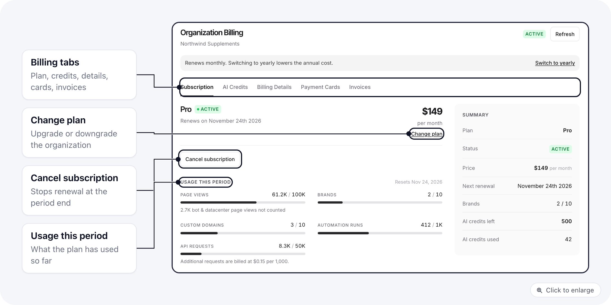
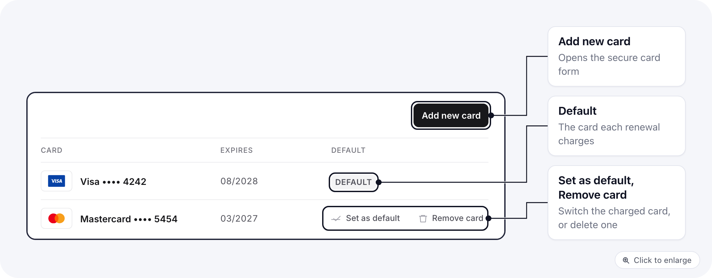
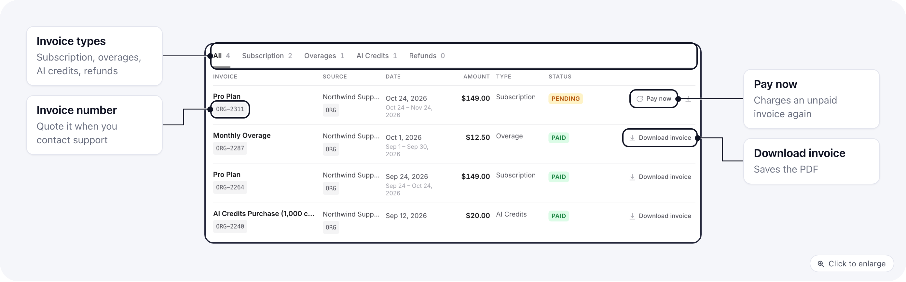

One organization pays for all of its brands. **Settings > Billing** opens **Organization Billing**, with five tabs: **Subscription**, **AI Credits**, **Billing Details**, **Payment Cards** and **Invoices**. Click **Refresh** at the top to reload everything.

## Who can open Billing

Owners always can. Anyone else needs a role with the Billing rows ticked (the **Finance** preset has them all), or **Organization > Settings**. The exact boxes, and a finance role to copy, are in [Give someone Billing](/settings/organization-roles#give-someone-billing).

Someone without that access who opens the page sees "Billing managed by another team".

## Subscription

The tab shows your plan, its status, the renewal date or the trial end date, the price and your usage.

- **Change plan** opens the plan picker. Upgrading takes effect right away and charges the prorated difference. Downgrading is scheduled: you keep the current plan until the date shown, and **Cancel downgrade** keeps you on it.
- **Switch to monthly** or **Switch to yearly** changes the billing cycle.
- **Cancel subscription** ends the plan. A canceled plan shows **Reactivate subscription** instead.

During a trial, a banner shows when the trial ends, with a link to add a payment card. Once a card is on file, billing starts automatically when the trial ends.

## Payment Cards

- **Add new card** adds a card.
- **Set as default** makes a card the one charged for renewals.
- **Remove card** removes a card that is not the default.

The default card can only be removed once the subscription is canceled and nothing is left unpaid. The same rule applies to **Delete all cards**.

## Invoices and credit notes

Invoices are listed with their **Source**, **Date**, **Amount**, **Type** and **Status**. Filter with the tabs **All**, **Subscription**, **Overages**, **AI Credits** and **Refunds**. A refund appears as a credit note.

Use **Download invoice**, or **Download credit note** for a refund, to get the document.

### Pay a failed invoice

When an organization invoice failed, or is still open or pending, its row shows **Pay now**. It charges your cards on file, starting with the default card. You need at least one saved card.

A success message confirms the payment and the invoice turns paid. If the card is declined you see "Payment did not go through"; add or choose another card under **Payment Cards**, then try again.

## AI Credits

The **AI Credits** tab shows the credits left and used. Click the purchase button, pick a package and confirm; the credits are added as soon as the card is charged, and the purchase appears under **Invoices > AI Credits**. You need a saved card first. If the charge fails, nothing is added.

What credits pay for and the package prices are in [AI credits](/account/ai-credits).

## Billing Details

Enter the name, email, tax ID and address that should appear on invoices, then save.

## Related

- [Organization roles](/settings/organization-roles#give-someone-billing)
- [AI credits](/account/ai-credits)
- [Organization settings](/settings/organization-settings)
