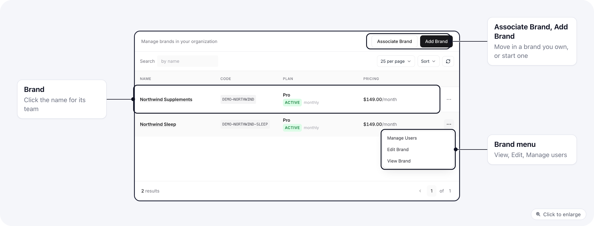
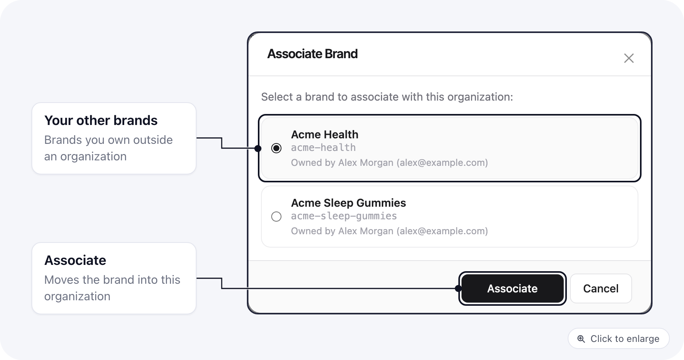
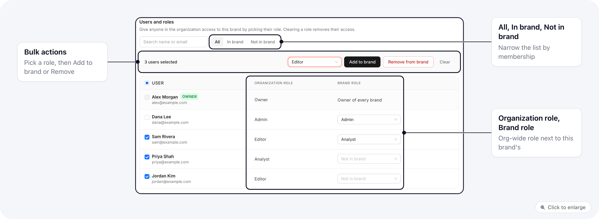

**Settings > Brands** lists every brand in the organization. Each brand has its own pages, products, orders and team; the organization decides who on the team can reach it.

## The brands list

Each row's menu has **Manage Users**, **Edit Brand** and **View Brand**. Brands cannot be deleted from this page.

## Add a new brand

1. Click **Add Brand**.
2. Enter the brand's name (3 to 64 characters) and save.

The organization's owners become owners of the new brand. Give the rest of the team access with **Manage Users**.

## Bring in an existing brand

Use **Associate Brand** for a brand a teammate already owns that is not part of the organization yet.

1. Click **Associate Brand**. The window lists brands owned by people in the organization, with the owner's name and email.
2. Pick the brand and click **Associate**.

If the list says no unassigned brands were found, check that the brand's owner is a member of the organization. With **Enforce domain restriction** on, only brands owned by people on your email domain are listed; see [organization settings](/settings/organization-settings#domain-and-access).

## Who can reach a brand

Click **Manage Users** in a brand's row to open its **Users and roles** tab.

Every member of the organization is listed with two roles:

- **Organization role**: their role in the organization, set on the [Users page](/settings/organization-users#change-a-users-role).
- **Brand role**: the role they have on this brand. This is the one that decides what they can do inside it. **Not in brand** means they cannot open it.

To change one person, pick a role in their **Brand role** column. To take their access away, use **Remove from brand**. Owners show **Owner of every brand** and cannot be changed here.

To change several people at once:

1. Use the filter (**All**, **In brand**, **Not in brand**) or the search to find them, and tick their rows.
2. Pick a role, then click **Add to brand**. Or click **Remove from brand** to take them all out.

The same access can be set from the person's side, on their user page under **Brands and roles**. Use whichever view is quicker: per brand here, per person there.

Members without a role that can change the organization see the tab read-only, with the note "You can view this brand's team but not change it."

## Brand details

The **Details** tab shows the brand's **Name**, **Code** and **Plan**. Change the name and click **Save**.

## Related

- [Organization users](/settings/organization-users)
- [Organization roles](/settings/organization-roles)
- [When a member has no brand](/settings/organization-no-brand-access)
