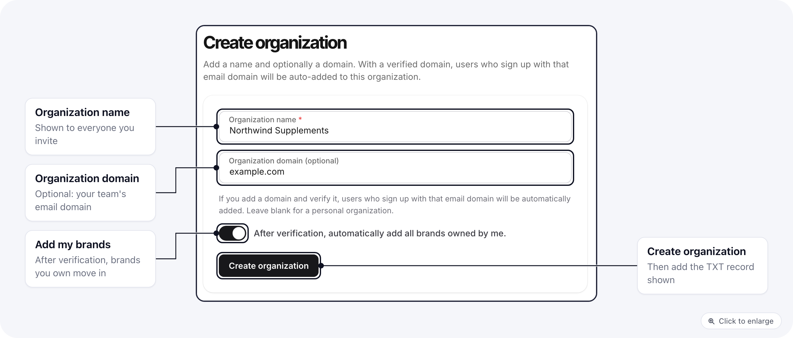
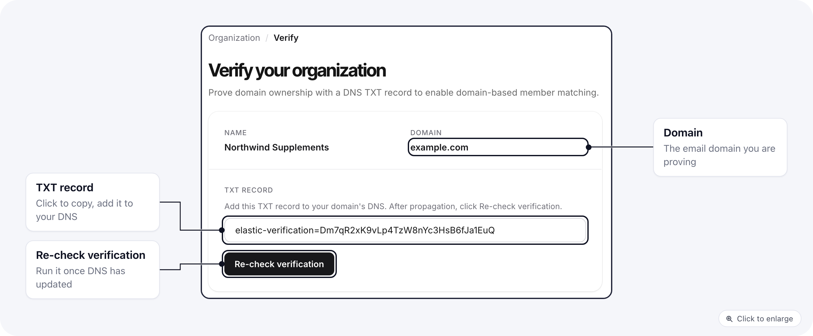

An organization holds your brands, your team and one shared billing account. If you work alone you may never need more than the one ElasticFunnels created for you. Create one when you want teammates who sign up with your company email to join automatically.

## Create the organization

If you do not belong to an organization yet, **Settings** shows **Create Organization** in the sidebar.

1. Enter the **Organization name**.
2. Optionally enter the **Organization domain**, for example `example.com`. This is the email domain your team uses. Leave it blank for a personal organization.
3. Turn on **After verification, automatically add all brands owned by me.** if your brands should move into the organization once the domain is verified.
4. Click **Create organization**.

You become the organization's owner. The organization starts with the built-in roles described in [Organization roles](/settings/organization-roles#the-built-in-roles).

## Verify the domain

If you entered a domain, the confirmation shows a **TXT record**. Click it to copy it.

1. In your DNS provider, add a TXT record on the domain itself (the root, for example `example.com`), with the copied value. It starts with `elastic-verification=`.
2. Wait for DNS to update. ElasticFunnels checks the record automatically every 30 minutes for the first 3 days.
3. To check sooner, open **Settings > Verify** and click **Re-check verification**.

When the record matches, the organization is verified, you get an email, and **Verify** disappears from the sidebar. Only an owner sees the Verify page.

## What happens after verification

- **Teammates join by email domain.** Everyone with an account on `@example.com`, and everyone who signs up with that domain later, is added to the organization with its default role. You can turn this off or change the default role in [organization settings](/settings/organization-settings#domain-and-access).
- **Your brands move in**, if you turned on the switch when creating the organization. Each brand you own becomes part of the organization.

People who join by domain get no brands yet. They see a waiting screen until someone gives them access; see [When a member has no brand](/settings/organization-no-brand-access).

## Related

- [Organization settings](/settings/organization-settings)
- [Organization brands](/settings/organization-brands)
- [Organization users](/settings/organization-users)
