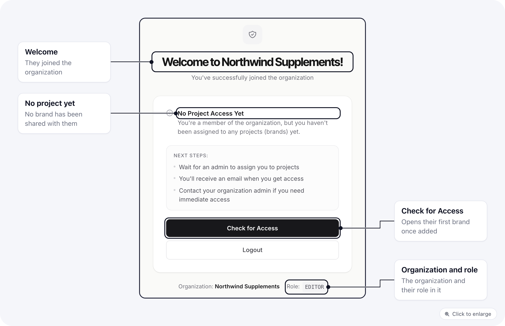

Someone can be a member of your organization and still have no brand to open. It happens when they joined automatically through your email domain, or when every brand was taken away from them.

## What they see

When they try to open one of the organization's brands, they land on a waiting screen instead.

It welcomes them to the organization, says **No Project Access Yet**, and shows their organization and role. **Check for Access** looks again: as soon as they have a brand, it opens that brand. **Logout** signs them out.

## Give them a brand

An owner, or a member whose role can change members, does one of these:

- On **Settings > Users**, open the person, go to **Brands and roles**, tick a brand, pick a role and click **Save brands and roles**. See [Brand access and a role per brand](/settings/organization-users#brand-access-and-a-role-per-brand).
- On **Settings > Brands**, click **Manage Users** on the brand and pick a role for them. See [Who can reach a brand](/settings/organization-brands#who-can-reach-a-brand).

Then ask them to click **Check for Access**.

## Stop it happening

People who join by domain always start without brands. If you would rather choose each person yourself, turn off **Automatically join organization by email domain** in [organization settings](/settings/organization-settings#domain-and-access) and [invite](/settings/organization-users#invite-a-user) them instead; an invitation always includes at least one brand.
