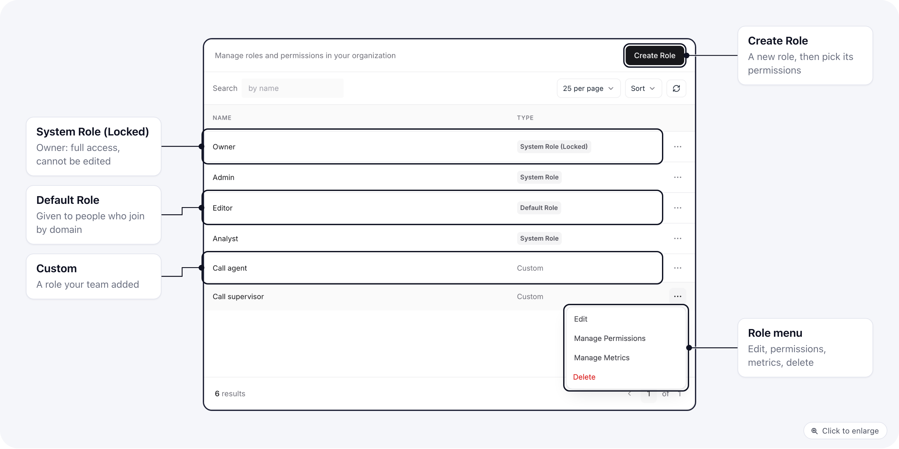
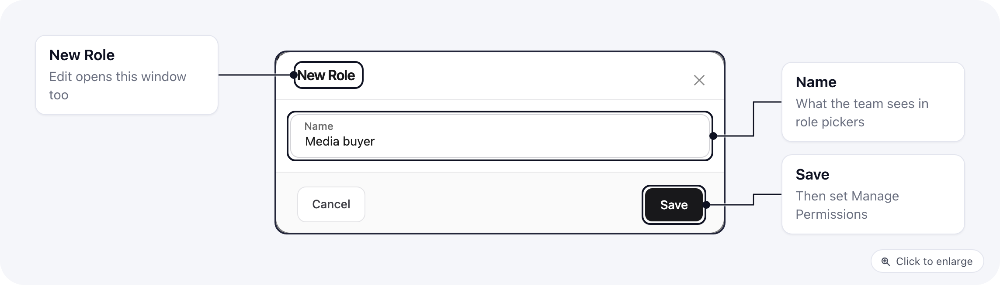
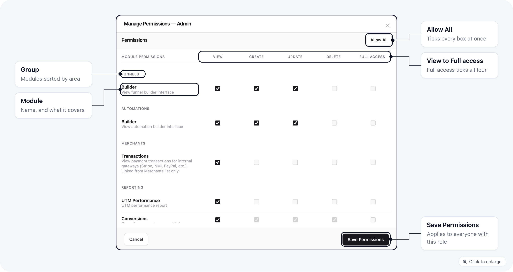
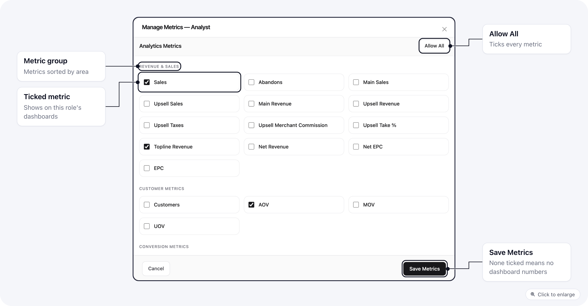
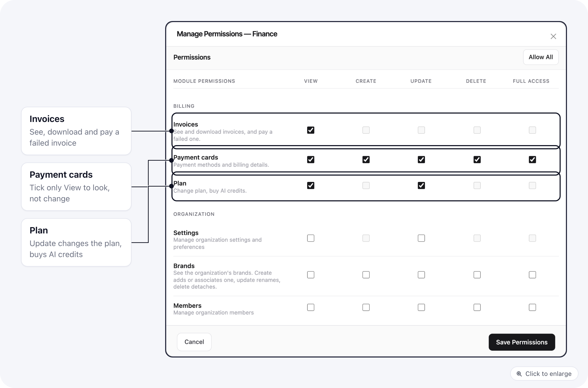
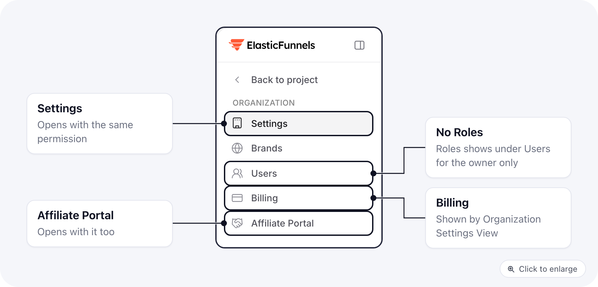

A role is a named set of permissions plus a list of the analytics numbers its members may see. You give each user a role when you [invite them](/settings/organization-users#invite-a-user), and you can give them a different role on each brand.

Only organization owners can open **Settings > Roles**. Other members do not see it in the menu, whatever their role allows.

## The roles list

The **Type** column tells you what kind of role each row is:

| Badge | Meaning |
|-------|---------|
| **System Role (Locked)** | The Owner role. It always has every permission and every metric, and it cannot be edited or deleted. |
| **Default Role** | The role people get when they join automatically through your email domain. You choose it in organization settings. |
| **System Role** | Admin, Editor and Analyst. You can edit their permissions and metrics, but you cannot delete them. |
| **Custom** | Every other role, including the ones you create. |

Each row's menu has **Edit** (rename), **Manage Permissions**, **Manage Metrics** and **Delete**.

## The built-in roles

New organizations start with these roles:

| Role | What it can do | Metrics |
|------|----------------|---------|
| **Owner** | Everything, including billing, organization settings and roles. | All |
| **Admin** | Every brand feature (pages, funnels, products, merchants, conversions, customers, reports, integrations, automations and more) and managing members. It does not include organization settings or Billing. | All |
| **Editor** | Build and edit pages, funnels, page components, quizzes, exit popups and collections; view domains and integrations; view and update conversions and tracking. | Traffic, conversion rate, revenue, sales, AOV and engagement |
| **Analyst** | View pages, funnels, domains, integrations, tracking and conversions. Nothing can be changed. | Traffic, conversion rate, revenue, sales and AOV |
| **Call agent** | The call center: make and log calls, view and create orders, manage subscriptions, view their commissions. | None |
| **Call supervisor** | Everything a call agent can do, plus supervising agents and call center setup. | None |

You can change any of them except Owner. Your changes apply to everyone who has the role.

## Create a role

1. Open **Settings > Roles** and click **Create Role**.
2. Enter a **Name**, for example "Finance".
3. Under **Start from a preset**, pick one of the presets below, or **Blank role** to start with nothing ticked. A preset fills in permissions and metrics. Use **Edit permissions** and **Edit metrics** under the list to change them before you save.
4. Click **Save**.
5. To change the role later, open its menu and pick **Manage Permissions** or **Manage Metrics**.

You cannot name a role "Owner".

## Role presets

When you create a role you can start from a preset and adjust it, instead of ticking every box yourself. A preset only fills in the new role. Changing presets later does not touch roles you already made.

| Preset | Starts with | Metrics |
|--------|-------------|---------|
| Finance | All of Billing (Invoices; Payment Cards; Plan View and Update), plus View on Conversions, Customers and Reports | Sales and revenue (total, main and upsell), net revenue, AOV, refund total and refund % |
| Support | View on Customers and Conversions, Update on Conversions | Sales, refund total and refund % |
| Fulfillment | View on Conversions and Products, Update on Conversions | None |
| Marketing analyst | View on Analytics, Reports, UTM performance, Segments, Tracking, Conversions, Split tests, Funnels and Pages | All |
| Page editor / contractor | Pages (View, Create, Update, Build), page components, files and funnels (View, Create, Update), and the funnel builder | None |
| Read-only | View on every brand area. Nothing in Billing, Organization or Call Center | Page views, sessions and clicks |

<Note>
Update on Conversions also allows refunds, so the Support and Fulfillment presets can refund an order. Remove that box if the person should not. The Read-only preset gets no Export boxes, but the app does not yet check Export everywhere, so treat exported data as visible to anyone who can view the list.
</Note>

## Manage Permissions

How to read the grid:

- **Rows** are areas of the app, such as Pages, Products or Customers, each with a one-line description. Rows that belong together sit under a heading: Affiliates, Funnels, Automations, Merchants, Reporting, Billing, Organization and Call Center.
- **View** lets the person open the area and see its lists. **Create** adds new items, **Update** changes existing ones, **Delete** removes them.
- **Full Access** ticks View, Create, Update and Delete for that row in one click.
- A greyed-out box means that action does not exist for the row. Logs, for example, only has View.
- **Allow All** at the top gives the role every permission. Click it again (it then reads **Remove All**) to clear the grid.

Click **Save Permissions** when you are done.

Some rows point at the same permission. Under **Reporting**, the Conversions, Subscriptions and Fulfillment rows all use the Conversions View permission, and the Customers row uses Customers View, so ticking one ticks the other.

Some rows have actions outside the four columns, such as **Export** on Conversions and Customers, **Build** on Pages, and the call center actions. They show as their own small checkboxes under the row name.

## Manage Metrics

Metrics decide which numbers a person sees on the dashboard, in analytics cards and in the metrics table. They are separate from permissions: a role can open Conversions and still see no revenue figures on the dashboard.

- Tick each metric the role may see. Metrics are grouped, for example **Revenue & Sales**, **Refund Metrics**, **Profitability Metrics**, **Cost Metrics**, **Advertising Metrics** and **Fulfillment Metrics**.
- **Allow All** gives every metric, including ones added later.
- A role with no metrics sees no dashboard numbers at all: no metric grid, no metric cards and no metrics table.

Click **Save Metrics** when you are done. You can also override metrics for one person on their user page, under **Metrics**.

## What happens when you change a role

When you save a role's permissions or metrics, everyone who holds that role gets the change right away, on every brand where they have it. A person who has a different role on one brand keeps it there.

<Warning>
Changing one person's **organization role** on their user page resets their brand roles and custom metrics to the new role. If they had a different role on one brand, or custom metrics, set those again afterwards.
</Warning>

## Delete a role

Pick **Delete** in the role's menu and confirm. Owner, Admin, Editor and Analyst cannot be deleted.

Move everyone off a role before you delete it: the people who still have it lose its permissions, and this cannot be undone.

## Give someone Billing

Billing is the organization's plan, payment cards and invoices. Neither Admin nor any other built-in role except Owner includes it, which is why a teammate set to Admin does not see **Billing** in their settings menu.

In **Manage Permissions**, under the **Billing** heading, tick:

| Row | Boxes | What it allows |
|-----|-------|----------------|
| **Invoices** | View | See invoices and credit notes. |
| **Payment Cards** | View, Create, Update, Delete | See the cards on file, add a card, change the default, remove a card. Tick only View for someone who should look but not change. |
| **Plan** | View, Update | View sees the current plan. Update changes the plan and buys AI credits. |

Invoices View also lets the person pay a failed invoice with **Pay now**.

**Organization > Settings** also grants Billing: View to see it, Update to change cards and the plan. It opens the organization **Settings** page as well, so use the Billing rows when the person should only handle billing. The quickest way is the **Finance** preset in **Create Role**.

Once saved, the person sees **Billing** in their settings menu.

## Worked examples

Each example is a custom role. Create it, then tick the boxes listed. Leave every other box empty.

### Finance: billing and revenue numbers, no page editing

For a bookkeeper or finance lead who pays the bills and reads the numbers.

**Permissions**

- Billing: everything in [Give someone Billing](#give-someone-billing).
- Reporting > Conversions: View. Reporting > Subscriptions: View. Reporting > Customers: View.
- Merchants > Transactions: View, if they reconcile payments with your gateway.
- No Pages, Funnels, Page Components or Templates boxes, so they cannot open or edit pages.

**Metrics**

- **Revenue & Sales**: Topline Revenue, Net Revenue, Sales, Main Revenue, Upsell Revenue.
- **Refund Metrics**: Refund Total, Refund %.
- **Profitability Metrics**: Profit, Profit %.
- **Cost Metrics**: COGS, Platform Fees, Taxes Collected, Fulfillment Cost.

### Support: customers and orders

For someone who answers customers and looks up their orders.

**Permissions**

- Customers: View.
- Conversions: View.
- Tickets: View, Create, Update, if you use Tickets.

**Metrics:** none. Support does not need dashboard numbers, and with no metrics the dashboard stays empty for them.

### Fulfillment ops

For someone who ships orders and fixes fulfillment problems.

**Permissions**

- Conversions: View, Update. View opens the fulfillment list; Update allows the actions on orders.
- Products: View, so they can check what each product contains.
- Integrations: View, only if they should see how your fulfillment provider is connected.

**Metrics**

- **Fulfillment Metrics**: Orders with Tracking, Total Fulfillment Cost, Avg Fulfillment Cost, Reconciliation Rate.

### Media buyer or analyst: reports and metrics only

For someone who reads traffic and ad results but changes nothing.

**Permissions**

- Tracking: View.
- Reporting > UTM Performance, Clicks, Campaigns, Conversions: View.
- Custom Reports: View. Add Create and Update if they should build their own reports.

**Metrics**

- **Advertising Metrics**: Ads: Spend, Ads: Clicks, Ads: CPC, Ads: CPA, Ads: CTR.
- **Revenue & Sales**: Topline Revenue, Sales, EPC.
- **Conversion Metrics**: Conversion Rate.
- **Efficiency Metrics**: Revenue Per Click, Profit Per Click.
- **Session Analytics** and **Page Analytics**: Sessions, Page Views.

## Test a role before you roll it out

Invite a test address with the new role and one brand, sign in as that user, and check the sidebar, a list they should open, a page they should not reach, and the dashboard numbers. Then give the role to the real team.

## Related

- [Organization users](/settings/organization-users): invite people and pick their brands.
- [Permission matrix](/essentials/permission-matrix): which permission each capability needs.
- [Restricted role troubleshooting](/essentials/restricted-role-troubleshooting): when someone sees too much or too little.
