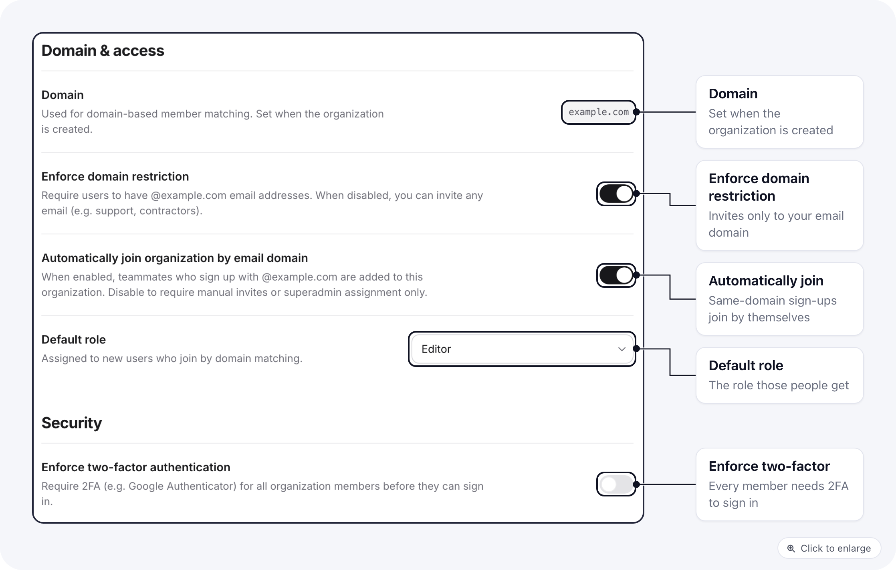
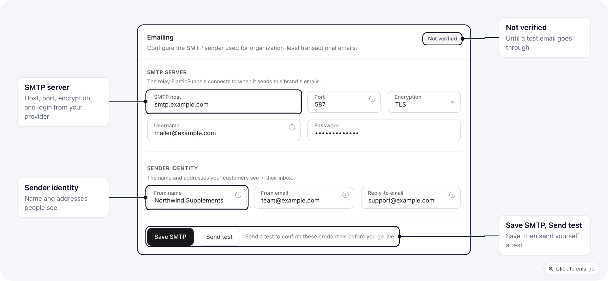

Open **Settings > Settings** under the organization items. Change what you need and click **Save changes** at the bottom; the SMTP block has its own save button.

Members whose role has **Organization > Settings** View can open this page. Saving changes is for owners.

## Identity

- **Organization name**: the name shown wherever the organization appears.
- **Organization code (URL slug)**: used in organization URLs such as `/acme-corp/callcenter`. Lowercase letters, digits and hyphens. Changing it breaks links that use the old code.

## Domain and access

- **Domain**: the email domain set when the organization was created. It is shown here and cannot be changed on this page. To verify it, see [Verify the domain](/settings/organization-create#verify-the-domain).
- **Enforce domain restriction**: when on, only brands that belong to members with an `@yourdomain` email address come into the organization. A brand created by someone on another email domain stays outside it, and **Associate Brand** only offers brands owned by people on your domain. Turn it off when people outside your company, such as an agency or a contractor, create brands that should be part of the organization.
- **Automatically join organization by email domain**: when on, people who sign up with your verified domain are added to the organization. Turn it off if every new member should come in through an [invitation](/settings/organization-users#invite-a-user).
- **Default role**: the role those people get when they join by domain. Owner cannot be the default role. Pick a role with little access; people who join this way have no brands until you give them some.

## Security

**Enforce two-factor authentication** requires every member to use a second factor when they sign in. Members who have not set one up are taken to the setup screen at their next sign-in, and nobody in the organization can turn two-factor authentication off while this is on.

The **Users** list shows each member's second-factor status, so you can see who still needs to set it up. Members set it up as described in [Two-factor authentication](/account/two-factor-authentication).

## Emailing (SMTP)

The **Emailing** block sets the SMTP server ElasticFunnels uses for organization-level transactional emails. Owners and admins can change it.

| Field | What to enter |
|-------|---------------|
| **SMTP host**, **Port**, **Encryption** | From your mail provider. Port 587 for TLS, 465 for SSL, 25 for an unencrypted relay. |
| **Username**, **Password** | Usually the full mailbox address your provider issued. Leave the password blank to keep the saved one. |
| **From name** | The sender name people see, for example your company name. |
| **From email** | An address on a domain your provider is allowed to send for. |
| **Reply-to email** | Where replies land. Use a mailbox someone reads. |

Click **Save SMTP**, then **Send test**. The block shows **Verified** with the date of the last successful test.

To change the wording of the organization's emails, click **Open emails** under **Email templates**.

## Related

- [Create an organization and verify its domain](/settings/organization-create)
- [Organization users](/settings/organization-users)
- [Organization roles](/settings/organization-roles)
