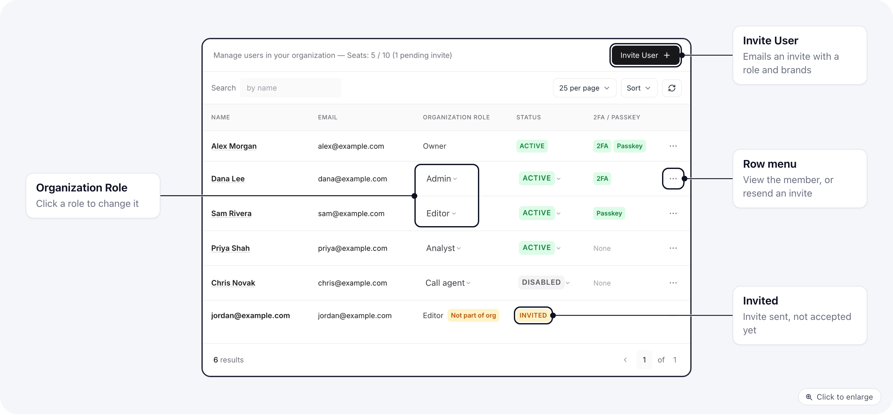
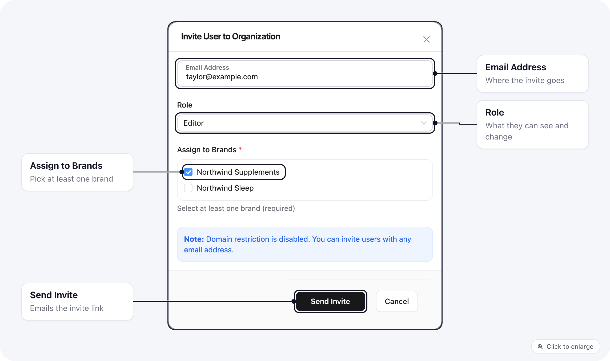
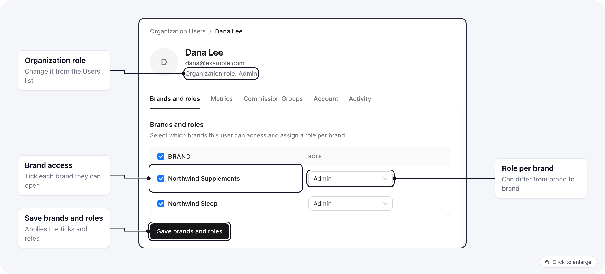
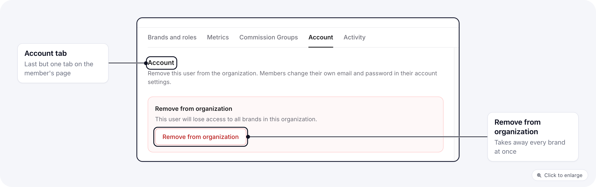

Everyone who works in your organization is listed under **Settings > Users**. From there you invite people, pick the role they get on each brand, and switch someone off or remove them. What a role allows is set on the [Roles page](/settings/organization-roles).

## Who can manage users

| Who | What they can do |
|-----|------------------|
| Owners | Everything on this page, including giving someone the Owner or Admin role. |
| Members whose role has **Organization > Members** | View allows them to open the list. Create lets them invite, Update lets them change roles, brands and status, Delete lets them remove people. |

A few limits apply to everyone who is not an owner:

- They cannot change or remove an owner or an admin.
- They cannot give anyone the Owner or Admin role, or any role that has every permission.
- They cannot invite someone as an admin.

Nobody can change their own role, brands or status, and the primary owner's role and status are locked.

## The users list

Each row shows the person's name, email, **Organization Role**, **Status** and whether they have set up a second factor. Pending invitations sit in the same list, marked **Invited**. When your plan has a seat limit, the page header shows how many seats are used, and a banner appears once the limit is reached.

Click a name, or **View** in the row menu, to open that user's page.

## Invite a user

1. Open **Settings > Users** and click **Invite User**.
2. Enter their **Email Address**.
3. Pick a **Role**. This becomes their organization role and their role on every brand you tick.
4. Under **Assign to Brands**, tick at least one brand.
5. Click **Send Invite**.

The invitation link is valid for 7 days. The invitation shows in the list as **Invited** until it is accepted. From its row menu you can **Resend invitation**, which replaces the old link with a new one, or **Cancel invitation**.

<Note>
An invitation can never make someone an owner. Invite them with another role, then an owner changes their role to Owner from the list.
</Note>

You cannot invite an email that already has a pending invitation or already belongs to the organization. If you have used every seat on your plan, the invite is refused until you upgrade or remove someone.

## What the invitee sees

The invitee gets an email inviting them to join your organization, with a button to accept.

- **New to ElasticFunnels:** the link opens a page where they enter their name and a password (at least 8 characters), then accept.
- **Already has an account:** they log in with the invited email address first, then open the link again. A different logged-in account cannot accept it.

Once they accept, they are signed in and land on the analytics page of the first brand you gave them. They see only the brands you ticked, and only what their role allows there.

## Change a user's role

In the list, click the role in the **Organization Role** column and pick a new one.

<Warning>
Changing the organization role resets this user's role on every brand to the new role, and resets their visible metrics to the new role's metrics. If you had given them different roles per brand, or custom metrics, set those again on their user page afterwards.
</Warning>

## Brand access and a role per brand

Open the user's page and go to **Brands and roles**.

- Tick the brands they should reach. Untick a brand to take it away.
- For each ticked brand, pick the role they have there. Someone can be an Editor on one brand and an Analyst on another.
- Click **Save brands and roles**.

Saving here resets the user's visible metrics to the metrics of the roles you picked. Set custom metrics after you save brands and roles.

### Custom metrics for one person

The **Metrics** tab on the user's page sets which analytics numbers this person sees across all their brands, whatever their role says. Tick the metrics, or use **Allow All**, then click **Save metrics**. See [Manage Metrics](/settings/organization-roles#manage-metrics) for what the metrics control.

## Pause or remove a user

- **Pause:** in the list, click their status and pick **Disabled**. They keep their role and brands but cannot open the organization or its brands until you set them back to **Active**.
- **Remove:** open their user page, go to **Account** and click **Remove from organization**. They lose access to every brand in the organization, and their open sessions are signed out. Owners cannot be removed this way, and you cannot remove yourself.

A disabled or removed user does not use a seat. Pending invitations hold a seat until they are accepted, canceled or expire. To bring back someone you removed, invite them again.

## Related

- [Organization roles](/settings/organization-roles): built-in roles, creating your own, and worked examples.
- [Roles, permissions, and metrics](/essentials/roles-permissions-metrics): how access is decided.
- [Restricted role troubleshooting](/essentials/restricted-role-troubleshooting): when someone sees too much or too little.
